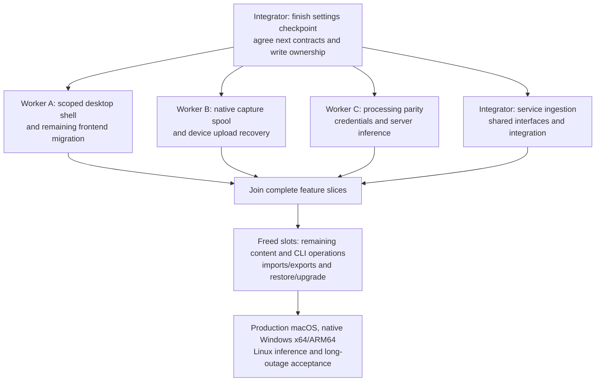

# Parallel implementation of frontend/backend separation

This distributes the remaining work in [the implementation plan](./frontend-backend-separation.md). It preserves that plan's full scope and release gates. It is a work allocation plan, not a claim that the unfinished features are implemented.

## Recommendation

Use **three implementation workers and one integrator**, matching the four available agent slots. Keep frontend migration under one owner, native capture under another, and processing/inference under a third. The integrator owns shared contracts, service-side capture integration and acceptance. Reassign finished slots to the next dependency on the critical path, including portable inference, remaining content operations, CLI ownership, imports/exports and deployment recovery.

This can materially shorten implementation because these tracks have different source ownership and can test against synthetic counterparts. Native builds, compound storage changes and final recording/platform acceptance still impose dependencies. Do not promise a fourfold speed-up or run several agents against the same mutable checkout.

The read-only distribution analysis used the current worktree at `16f77389a` plus the in-progress processing-settings changes. The current settings increment must be validated and committed before implementation workers branch from it. That checkpoint includes settings persistence, policy/model selection and thin clients; owner-managed vault credentials remain unfinished.

## Verified seams and hazards

- The main desktop shell still initializes local startup in `apps/desktop/src/main.tsx` and mounts `LocalVaultProvider` in `main/layout.tsx`. The older `shared/application/client.ts` facade always selects local commands; it is distinct from the IPC/HTTPS `vault-client.ts`.
- Several queued mutations resolve that older facade when the queued closure executes. Replacing it with a mutable global active client can send a delayed write to the wrong vault. Capture the scoped client at dispatch; scope tabs, pinned/recent notes, undo, queries and recovery by connection/account/vault. Identical session IDs across vaults must be safe.
- Native startup in `apps/desktop/src-tauri/src/lib.rs` and eager vault initialization in `plugins/settings/src/lib.rs` still open a local vault. Remote-only startup needs a native bootstrap/device-settings change as well as a frontend selector.
- `listener-core/src/actors/source/pipeline.rs` already separates recording and live transcription delivery. Its recorder writes directly into local session directories; its live buffer is not durable upload recovery. Preserve the local sink while adding a device spool sink.
- The whole `listener-core` crate cannot be imported into the server: it pulls device/audio/host dependencies and uses globally named actors. Extract portable processing or use explicitly scoped/serialized workers. `listener2-core::BatchRuntime` is an existing reusable seam.
- `loofah-core/src/jobs/result.rs` retains generated tag suggestions, but the worker currently applies the document body. Existing title/tag/template behavior remains in frontend AI task configurations. One processing owner must migrate this policy and its compound recovery together.
- `apps/cli/src/vault.rs::local_store` still opens independent writable stores. Remote agent reads exist; remote mutations and active-owner routing do not. MCP must remain read-only.
- Server deployment recipes exist, but full-service restore/upgrade, Linux inference and durable capture acceptance remain real implementation/validation work.

## First-wave ownership

Paths below are relative to the repository. New module names are proposed locations; agree declarations before parallel edits. Read each subtree's applicable `AGENTS.md` and skills before changing it.

| Owner                  | First independently reviewable result                                                                   | Exclusive feature files                                                                                                                                                                                                                                                           | Dependencies and acceptance                                                                                                                                                                                                                                                                                                   | Relative effort         |
| ---------------------- | ------------------------------------------------------------------------------------------------------- | --------------------------------------------------------------------------------------------------------------------------------------------------------------------------------------------------------------------------------------------------------------------------------- | ----------------------------------------------------------------------------------------------------------------------------------------------------------------------------------------------------------------------------------------------------------------------------------------------------------------------------- | ----------------------- |
| **A — desktop**        | Scope existing reads and device UI state, then mount the selected vault in the main shell               | `apps/desktop/src/main.tsx`, `main/layout.tsx`, `main/lifecycle.tsx`, `shared/startup-boundary.tsx`, feature queries under session/people/tags/sidebar/search, editor/task bridges, tab/pinned/recent/undo state, profile-selection UI                                            | Existing `VaultClient` supports a useful first slice immediately. Native remote-only bootstrap comes from the integrator. Test identical IDs in different vaults, delayed work across switching, teardown, revoked/read-only access and default local offline startup.                                                        | Large                   |
| **B — device capture** | Durable native spool with a fake uploader, then real upload/recovery                                    | New portable spool module/crate; `listener-core/src/actors/recorder/`, related source/session lifecycle; `plugins/transcription/src/listener/`; native recording metadata and capture-host modules                                                                                | Agree destination/chunk/recovery contracts first. Preserve both macOS and Windows capture implementations. Prove capture starts without a network, bounded buffering, checksums, disk-full handling, killed-process recovery and retained data after access loss.                                                             | Very large              |
| **C — processing**     | Complete summary/title/tag/template policy and owner-managed credentials, then portable live/batch STT  | `loofah-core/src/jobs/` feature implementations; generated-document transaction/recovery modules in `vault-write`; new server secrets/model-resource/STT modules; feature implementation in `apps/server/src/processing.rs`; narrowly scoped portable transcription/model modules | Build on the settings checkpoint. Agree compound result/source reservations and preview contracts. Match existing prompt/result/task/tag/title/image behavior. Keys are owner-only writes with no readback; editors select permitted models. Inference must run without Tauri/devices and execute on Linux CPU.               | Very large              |
| **Integrator**         | Minimal shared interfaces plus authenticated service ingestion/finalization, integrated in small slices | Shared contract/registration files listed below; new `loofah-core` capture-ingestion modules, server capture routes, native SDK capture transport and cross-track fixtures                                                                                                        | Use synthetic sender/audio while B/C work independently. Own the single canonical recording/transcript publication path and recording/STT-versus-summary write reservations. Hold authorization through commits. Reserve capacity for integration and reviews; move ingestion to a freed worker if it becomes the bottleneck. | Large, plus integration |

Worker A must not independently port AI policy from TypeScript. Worker C implements it in Rust; A consumes the resulting jobs/subscriptions. B owns device capture and spool lifetime; the integrator owns service receipts and canonical publication. C supplies transcription engines and processing orchestration through the agreed ingestion interface.

## Contracts and files with one integration owner

The integrator owns changes to these shared junctions:

- `crates/loofah-protocol/**`, compatibility fixtures and generated TypeScript contracts.
- `crates/loofah-client/src/requests.rs` operation/reply unions and module registration. Workers can own separate new transport/spool files.
- `apps/desktop/src/shared/application/vault-client.ts` and `vault-scope.ts` public interfaces, cache lifetime and invalidation rules.
- `VaultContext`, runtime composition, root module registration and shared storage reservations. The processing worker owns generation transaction implementation; capture changes to the same transaction files go through that owner and the integrator.
- Native `application.rs`, `lib.rs`, startup/shutdown registration and device-settings/bootstrap interfaces. Workers supply feature modules and targeted integration patches.
- HTTP router/service registration, workspace manifests, `Cargo.lock`, generated native bindings, locale generation, CI orchestration and the main plan audit.

Do not freeze a speculative API for every remaining feature at once. Agree the smallest contract for each next reviewable slice, register its module/traits centrally, then let the owning worker implement it. Workers request interface changes before coding dependent callers; the integrator updates the base and workers rebase at a clean checkpoint.

For capture, agree these invariants before B and the service-ingestion implementation diverge:

1. Immutable server/profile/member/vault/session/recording identity. An offline-started capture can await session creation; it does not create a general editable offline remote session.
2. Chunk sequence, encoding, sample rate, channel map, exact sample/byte counts and checksum; define existing-recording append/resume behavior.
3. Durable acknowledgments, contiguous received cursor, replay/status semantics and rejection of changed duplicate declarations.
4. Separate device capture, upload, server finalization and transcription/repair states. Cancellation, expired credentials and deleted/revoked destinations have explicit recovery behavior.
5. Recording/STT write reservations and transcript repair revisions. Summary application must wait for confirmed finalization/repair, with no frontend callback required to trigger the next job.
6. Device cleanup requires proof of verified canonical server publication. A chunk acknowledgment alone cannot delete the only complete recording.

Reuse authenticated HTTPS operations and SSE wherever they satisfy the live-caption contract. The architecture plan allows a separate audio streaming transport. Decide the chunk cadence/streaming implementation through measured caption latency, bandwidth and reconnect tests; add authenticated WebSocket streaming when required. Do not replace live transcription with eventual batch transcription to simplify the split.

## Worktree, build and merge protocol

1. Finish the integrator's current settings changes: generated contracts, relevant tests/checks, documentation and a clean commit. Record its full SHA as the implementation workers' base. Do not branch workers from the current dirty checkout or treat older CI as evidence for these new changes.
2. Create separate worktrees on T7, for example `/Volumes/T7/src/loofah-separation-ui`, `loofah-separation-capture` and `loofah-separation-processing`, with `refactor/` branches. Give each agent its absolute cwd, base SHA, owned files, contract version and acceptance criteria.
3. Run `scripts/setup-shared-target.sh` before Rust builds in each new worktree. Set `LOOFAH_TARGET_CACHE` to a physical T7 directory, and verify both root and native target symlinks resolve physically to T7. Put temporary files, pnpm/native/module caches, logs and evidence there too.
4. Workers commit small complete slices and report exact SHAs, changed APIs, checks/results, evidence paths and remaining limitations. They do not push the integration branch, release, regenerate shared contracts/locales or edit another worker's files.
5. The integrator reviews and cherry-picks one slice at a time, resolves semantic conflicts, regenerates shared artifacts once, and runs combined checks. Never cherry-pick into an already dirty integration worktree.
6. Keep each worker's Rust sources fixed during its dependent builds. Shared Cargo target locks serialize builds even across separate worktrees: schedule expensive native builds centrally and allow lightweight frontend/pure-core work alongside them. Give integration contract checks priority when a frontend worker is waiting on that contract; start cold engine builds after that checkpoint. Keep related Cargo package/feature selections consistent when practical to reduce recompilation. Do not duplicate large caches or start cold builds merely to avoid a short lock wait. Accelerated multi-hour audio fixtures also create substantial shared disk load; schedule them separately from timing-sensitive acceptance checks.
7. Avoid full native test runs that rewrite `test::export_types` output on worker branches; the integrator owns binding export. Workers run focused tests or explicitly skip that generator test where appropriate.
8. Batch integration pushes after healthy native Windows CI on the previous pushed head finishes. Do not cancel/restart healthy builds or CI because an observation times out. Draft PR #123 remains the integration review surface; no merge/release until the full goal passes.

At the distribution-analysis checkpoint, the three agents were read-only. Implementation starts only after the validated settings commit and creation of their separate worktrees. Any exception to the integrator-owned registration files must be explicit and limited to the assigned package.

## Subsequent scheduling

| Checkpoint                      | Desktop slot                                                                                         | Capture slot                                                                  | Processing slot                                                                                | Integrator                                                                               |
| ------------------------------- | ---------------------------------------------------------------------------------------------------- | ----------------------------------------------------------------------------- | ---------------------------------------------------------------------------------------------- | ---------------------------------------------------------------------------------------- |
| **First slices**                | Scoped reads/state, then main-shell/profile migration                                                | Spool/sink and restart recovery against fake uploader                         | Summary/title/tag/template fidelity and credential operations                                  | Settings checkpoint, minimal contracts, native bootstrap and service ingestion           |
| **Join capture and processing** | Remaining content/asset views; capture state, captions and recovery presentation when contracts land | Real SDK uploader, lost replies, resume/finalization and access-loss recovery | Linux model resources, live/batch transcription, repair and post-recording orchestration       | Canonical publication/reservations; real HTTPS integration; contract compatibility       |
| **Freed slots**                 | Take the highest-priority ready package below, with explicit file ownership before starting          | Continue capture reliability; release a slot after a verified checkpoint      | Hand portable inference to a free worker if generation work would otherwise delay live capture | Keep an assigned owner for every package; prioritize work blocking end-to-end acceptance |
| **Final validation**            | Main-shell/local-regression and realistic-vault UX                                                   | Two-hour capture/outages and device recovery                                  | Real model/provider and inference admission checks                                             | Combined production/platform acceptance, compatibility, docs and completion audit        |

Do not leave the following as implicit follow-up work:

- **Portable inference handoff:** if C is still completing compound generation/credentials when a slot frees, separate engine/model portability into that slot. Reserve its transcription files explicitly so it can run alongside generation work. Server live transcription remains on the critical path.
- **Remaining shared content operations:** assign a freed backend-capable worker to session delete/restore/permanent-empty operations, people/tag/template registry mutations and compound task movement/source changes that the main shell still needs. A owns their frontend consumers. Agree revisions, recovery and invalidation first; CLI mutations reuse these operations instead of implementing a second write path.
- **CLI owner bridge and mutations:** user-restricted macOS Unix socket and Windows named pipe; shared-core fallback only when no owner holds the vault lock. Preserve CLI output contracts and read-only MCP names. Test stale endpoints, concurrent startup, owner death and remote profile behavior.
- **Imports/exports:** move processing orchestration out of React; upload remote inputs, run shared jobs, download verified exports, then use device-native save/open actions. Preserve existing supported workflows and PDF attachment handling.
- **Attachment recovery:** finish incoming-stage cleanup and durable upload restart behavior without enumerating unknown session files.
- **Deployment recovery:** restore catalog, vaults, required job/upload/capture bookkeeping and separately protected secrets into a fresh service; rebuild caches, reject future schemas and test interrupted upgrades/proxy reconnects.

The integrator assigns these packages to available slots at checkpoint boundaries. Prefer an unfinished dependency of capture/main-shell acceptance over starting an unrelated tail task. CLI/content implementation can proceed against completed contracts while the long capture tests run. Do not silently leave a package unowned because its original worker is busy.

## Acceptance ownership and stop conditions

Each worker supplies focused regression evidence with its slice. The integrator owns combined acceptance and the final requirement-by-requirement audit; no worker can declare the full plan complete.

- Every integrated slice preserves default standalone/offline local use with **no Loofah login/account/SSO**. Remote failure cannot fall back to a local vault.
- Match IPC/HTTPS behavior, typed errors, cancellation/unknown outcomes, scoped event invalidation, conflict recovery and generated-contract/version checks. No feature UI branches on deployment transport.
- Verify canonical files, attachment ownership, unknown/dot-file exclusion, legacy compatibility, concurrent edits, partial failures and authorization through commit. Do not replace source-of-truth checks with cache counts.
- Exercise actual HTTPS/proxy behavior at 50/150/500 ms RTT with jitter, constrained bandwidth, dropped acknowledgments, token refresh, server restart and event resync. Synthetic seams enable parallel implementation; they do not prove end-to-end acceptance.
- Run at least two hours of capture with repeated outages and a ten-minute disconnect, restart after capture and restart the server. Verify audio hashes, duration/channel alignment, deduplication, transcript repair and cleanup proof.
- Execute Linux CPU live/batch transcription and diarization; enforce the headless dependency graph. Preserve native macOS behavior and run Windows x64/ARM64 checks **and real speech-model lanes** for processing work.
- Validate production macOS responsiveness with realistic vault sizes while capture, upload, search and AI compete. Validate backup/restore, upgrades and older-client/newer-server compatibility.

If two tracks need to change the same transaction/lifecycle invariant, sequence that change through its owner before resuming parallel edits. If integration becomes the bottleneck, stop starting new features and use an available worker for reviews, fixtures or acceptance. Keep the original objective active until all implementation and release gates are demonstrated; bases, CRDTs, general remote offline synchronization, mobile clients and real-time collaborative editing remain excluded.

## Current integration checkpoint

See [the handoff](./frontend-backend-handoff.md) for current SHAs, fixed trees,
verification and exclusive cache ownership. Default local use stays offline and
login-free. The full objective remains active; no merge or release yet.

The first-wave descriptions above are historical. Current allocation:

- A: main attachment presentation, canonical references, scoped upload/resource
  lifecycle and local Finder/Explorer behavior through the client adapter.
- B: bounded background capture uploader and native coordinator, using the existing
  durable spool/recorder. Verify lost acknowledgments, offline capture, immutable
  destination, reopen/resume, independently hashed publication and actual drains.
- C: Ubuntu 24.04 CPU packaging/CI, single-source native setup and configured
  capability checks. Preserve the default notes-only image; distinguish tested
  runtime artifacts from the standalone Docker builder qualification.
- Root: saved-profile/remote-only startup, contracts and generated bindings,
  public recording commands/quit/UI integration, remaining workflows and acceptance.

Durable Core batch jobs, the CPU adapter/activation and authenticated HTTP/SDK
operations are integrated. The actual model-to-canonical path passed on macOS;
Linux qualification remains required. The startup cohort passes 122 desktop,
15 settings and 18 SDK profile tests, actual binding generation, desktop/CLI Rust
checks, 2,367 frontend tests and typechecking. Keep the experimental remote notes
workspace distinct from complete main-shell/feature parity.

Both Windows jobs on pushed `09495af6f` finished successfully. Its macOS/headless
fixture and Linux real-CPU drain-deadline failures have source corrections in Root;
run fresh CI on the next validated batch. The last entirely green head remains
`93dada10bb`. Do not wait for an old failed SHA to turn green before pushing its fix.

Reuse these existing worktrees. In particular, use Root's fixed bootstrap tree for
consolidated native builds instead of compiling identical integration source from
another absolute path. Batch full builds, contract generation and pushes around
coherent features. Use focused checks between them; do not repeat broad checks
without new source, failures or unresolved concerns. Keep dependent Rust source
frozen, caches exclusive and exact nonzero test inventories/source hashes. Never
cancel healthy work or create a cold cache simply to bypass a lock.
