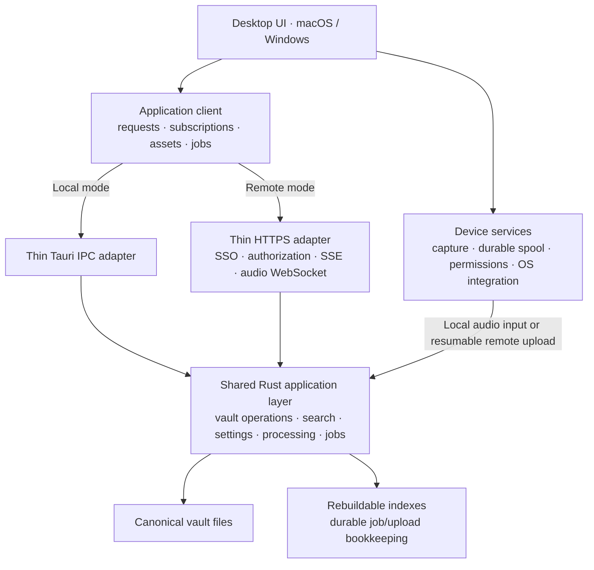

# Separate Loofah’s application backend from its desktop shell

Status: implementation in progress. The architecture and release gates below remain the full target; see the implementation audit at the end. Functionality is proposed unless verified there.

Inspection baseline: clean `main` at `a6a8f001d`, November 5, 2026. Root instructions and applicable plugin, fs-sync, and documentation instructions were inspected. No implementation or runtime testing was performed while preparing this plan.

## 1. Architecture and verified starting point

Build one Rust application layer that runs either **inside the desktop process** or **inside a standalone server**. Keep the existing macOS and Windows standalone experience, including offline use. Support Linux x64 for the standalone server.

### Local experience is a release requirement

For a single-person installation running everything on one device, nothing should change significantly: install Loofah, open it, and work locally or offline as today. Local mode is the default. The backend runs inside the desktop app, with no login, account, SSO, separately installed server, or company/vault administration required. Do not introduce remote provisioning or authentication into local startup. Login and shared-vault controls apply only when someone explicitly connects to a remote server.

Preserving this local onboarding and operating experience is an explicit acceptance criterion for every migration phase and the final release.

The first remote release includes the decisions made during planning:

- Company SSO.
- A personal vault automatically provisioned for each member.
- Self-service creation of shared vaults and membership management.
- Sharing with existing members of the configured company who have signed into Loofah.
- All remote-mode AI processing on the server, including live transcription.
- Online editing, with recovery of unsaved text and durable recording uploads during outages.
- ChatGPT subscription login remains local-only initially.

The shared layer is instantiated in the selected host; the diagram does not imply that local mode contacts a server.

### Findings from the current code

| Area                        | Verified boundary and implication                                                                                                                                                                                                                                                                                                              |
| --------------------------- | ---------------------------------------------------------------------------------------------------------------------------------------------------------------------------------------------------------------------------------------------------------------------------------------------------------------------------------------------- |
| Vault format                | [`vault-read`](../../crates/vault-read/src/lib.rs) already provides Tauri-independent readers and types. [`reserved.rs`](../../crates/vault-read/src/reserved.rs) defines exact session ownership. Preserve these contracts.                                                                                                                   |
| Vault writes                | [`vault-write::SessionStore`](../../crates/vault-write/src/lib.rs) already owns writes, in-memory indexing, transcript buffering, recording reservations, and change channels. Tauri event integration is optional. This is the foundation, not something to rewrite.                                                                          |
| IPC                         | [`session_store/commands.rs`](../../apps/desktop/src-tauri/src/session_store/commands.rs) mostly delegates to `SessionStore`. Some commands obtain settings or apply policy before delegation; move that policy into the shared layer. Errors currently cross IPC predominantly as strings.                                                    |
| Lifecycle and indexing      | [`startup.rs`](../../apps/desktop/src-tauri/src/startup.rs), [`vault_watch.rs`](../../apps/desktop/src-tauri/src/vault_watch.rs), and [`search_index.rs`](../../apps/desktop/src-tauri/src/search_index.rs) contain reusable orchestration wrapped in Tauri state/events. `search-cache` already provides the reusable Tantivy implementation. |
| Frontend data access        | [`index-query.ts`](../../apps/desktop/src/shared/index-query.ts) directly subscribes to Tauri events and assumes local requests, including `networkMode: "always"`. Session queries directly import generated Tauri commands. Replace those dependencies at the client boundary.                                                               |
| Concurrent editing          | [`save_note`](../../crates/vault-write/src/content.rs) serializes writes but accepts no expected revision. Summaries have an existing content comparison guard. A mutex prevents simultaneous execution, but does not prevent a later stale save from overwriting another client’s edit.                                                       |
| Recording and processing    | `listener-core` and `listener2-core` are reusable Rust crates with runtime interfaces, but capture and processing remain intertwined. [`useStartListening.ts`](../../apps/desktop/src/stt/useStartListening.ts) still coordinates transcript persistence, batch repair, and automatic summaries in the frontend.                               |
| AI workflows                | [`enhance-workflow.ts`](../../apps/desktop/src/store/zustand/ai-task/task-configs/enhance-workflow.ts) runs generation in TypeScript using the AI SDK. Provider construction, retries, validation, and success handling also span frontend modules. Extraction therefore includes moving business logic from TypeScript into Rust.             |
| Device and path assumptions | Attachment resolution and audio playback use `convertFileSrc`; imports accept local filesystem paths. Settings mix device preferences and vault behavior. Provider secrets currently live in the OS keychain. These cannot be exposed unchanged as remote APIs.                                                                                |
| CLI/MCP                     | [`apps/cli`](../../apps/cli/src/lib.rs) already operates without Tauri, using `agent-access`, `search-cache`, and `vault-write`. CLI mutations instantiate stores directly. [`mcp.rs`](../../apps/cli/src/mcp.rs) currently exposes read-only local tools/resources. Preserve that public capability boundary.                                 |
| Server portability          | Soniqo currently rejects Linux; its Windows implementation uses global live/batch state. Recording and batch actors also have global names. Linux support and concurrent processing require explicit work, even though much of the Rust code is already Tauri-independent.                                                                     |

Do not repurpose `plugins/relay` as the production backend. It is a Tauri-dependent development bridge.

## 2. Recommended boundaries and contracts

### Shared application layer

Introduce `crates/loofah-core`, composing existing components rather than relocating every crate:

- One `VaultContext` per opened vault: `SessionStore`, settings, search projection, watcher, event stream, and job coordination.
- Application operations for sessions, notes, summaries, transcripts, tasks, tags, people, attachments, imports, exports, and settings.
- Rust-owned recording ingestion, transcript persistence, post-recording repair, automatic summarization, and title generation.
- Shared provider implementations, prompt preparation, validation, retry policy, cancellation, and result application.
- Explicit startup, readiness, shutdown, and recovery interfaces.

Keep serialization and file-integrity primitives in `vault-read`, `vault-write`, `storage`, and `fs-sync-core`. Continue using `agent-access` for agent-facing projections.

Inject small host interfaces for secrets, runtime directories, processing resources, and notifications. Do not pass `AppHandle`, webview channels, or platform paths through application operations.

Device capture, permissions, microphone selection, system audio, tray/floating windows, browser launch, notifications, dialogs, and desktop updating remain in the desktop host. Split the processing portion of `listener-core` away from capture dependencies so the server does not require a desktop/audio-device stack.

### Public contracts and adapters

Introduce `crates/loofah-protocol` for shared request, response, error, event, revision, job, and asset DTOs. Generate TypeScript types using the repository’s existing Serde/Specta tooling. Keep endpoint registration and contract fixtures alongside these definitions.

Use explicit, versioned JSON operations under `/api/v1`, with separate endpoints for binary uploads, media, events, and audio streaming. Do not expose generic Tauri command invocation, arbitrary file reads/writes, or server filesystem paths.

Both adapters call the same application methods:

- **IPC:** existing generated command surface becomes thin adapter code.
- **HTTPS:** Axum handles authentication, transport validation, limits, and serialization.
- **Frontend:** one `ApplicationClient` exposes requests, subscriptions, job control, and asset resolution. UI components consume that interface.
- **Native remote transport:** Rust handles HTTPS connections and SSO credentials; the TypeScript remote adapter uses a narrow native bridge. Credentials stay out of ordinary UI state.

Use a separate device-services interface for capture and OS actions. Mode selection belongs in application bootstrap, not feature components.

### Errors, cancellation, and compatibility

- Return typed errors: validation, not found, forbidden, conflict, unavailable, incompatible version, resource limit, cancelled, and internal failure.
- Include request IDs, retryability, and current revision where useful. Never expose provider secrets or server paths.
- Distinguish a failed operation from a write that persisted before a later step failed. A dropped connection means the outcome may be unknown.
- Give mutations request IDs and replay-safe handling. Persist receipts for uploads, session creation, and job submission so retries cannot duplicate them.
- Reads accept cancellation. Cancelling a request does not roll back a committed write.
- Long operations return job IDs. Explicit cancellation is cooperative and observable; disconnecting a subscriber does not cancel a job.
- Negotiate protocol version and capabilities before opening a remote vault. Start with protocol major `1`; allow additive changes within that major and reject incompatible clients before mutations.
- Keep application version, API version, and vault-format compatibility separate. Existing automatic desktop releases must not require simultaneous server upgrades.

### Notifications and cache invalidation

Use authenticated **SSE for changes and job updates**, and a separate authenticated **WebSocket for live audio ingestion**. Axum already supports SSE and keepalives. [Axum SSE documentation](https://docs.rs/axum/latest/axum/response/sse/)

Extend existing entity/ID invalidations with vault identity, server epoch, and sequence cursor:

- Maintain a bounded replay buffer; no durable collaboration event log.
- Subscribe before initial reads. Revalidate after subscription establishment.
- On cursor gaps, buffer overflow, or server restart, send `resync_required` and invalidate the affected vault’s queries.
- Reconnect with bounded exponential backoff and jitter; heartbeat failures update connection state.
- Emit search-ready changes after projection updates so a query is not left stale after an early content notification.
- Job state and transcript snapshots remain queryable; progress events are not the sole record.
- Namespace caches and pending operations by connection, authenticated principal, and vault ID.
- Preserve invalidations and newer reads that arrive before an older save acknowledgement; refresh that resource after confirmation rather than leaving an old reply cached indefinitely.
- Run native mutations without the browser offline queue. Device recovery writes and clipboard operations remain available offline; remote requests report native connectivity errors and require their explicit retry/conflict policy.
- Tear down subscriptions and clear visible remote data on account changes or lost access.

Preserve local offline query behavior. Remote connection handling must not pause local-mode queries merely because the machine has no internet connection.

### Vault ownership, authorization, and editing

Run one service instance over its configured storage root. It manages multiple vaults, each with an exclusive lifetime lock. Reject overlapping roots and a second process opening the same writable vault. Do not support active-active servers or writable network-shared mounts initially.

Use a small, atomically written **service catalog** outside session directories for identities, memberships, vault roots, and provisioning state. Canonical note content remains exclusively in vault files; search remains rebuildable.

Initial remote access model:

- One configured company OIDC issuer.
- Identity keyed by issuer and subject, not mutable email addresses.
- First successful authorized sign-in idempotently provisions one personal vault.
- Personal vaults are private and cannot be shared through the sharing UI.
- Members can create shared vaults; the creator becomes owner.
- Owners can add existing company members as readers, editors, or owners, remove members, and rename/delete shared vaults.
- Readers can read and search; editors can change content and run processing; owners also manage membership and vault policy.
- Prevent removal of the last owner.
- No external guests, invitation emails, cross-company tenancy, or automatic access to every shared vault.

Use authorization-code login with PKCE through the system browser and a native loopback callback. Validate access tokens against configured issuer, signature, audience, expiry, and required scopes; do not use ID tokens as API credentials. [OAuth for native apps](https://www.rfc-editor.org/rfc/rfc8252.html), [JWT access-token validation](https://www.rfc-editor.org/rfc/rfc9068.html)

Check authorization for every request, stream, upload, media access, and job operation. Membership removal closes affected streams and prevents further job result application. Remote vault paths are selected only through the server catalog.

Local mode does not instantiate this remote identity/provisioning flow. Its trusted local application context accesses the user’s existing vault without asking the user to authenticate.

For concurrent writes:

- Return opaque revisions for editable resources.
- Require expected revisions for full replacements and destructive operations.
- Compare against current canonical content under the vault write lock, rather than relying solely on cached index state.
- Keep note/title revisions independent of unrelated live transcript updates.
- Return conflicts without overwriting either version. Preserve the local draft and offer reload, copy, or explicit reconciliation against the latest revision.
- Apply generated results only when their target revision remains valid; retain conflicted output for review.
- Retain the existing overwrite protection, trash behavior, legacy-note fallback, and watcher hash checks.
- Document that per-file atomic writes are not multi-file transactions. Add recovery records for compound operations and test partial failures.

External filesystem editing remains supported locally. On server-owned vaults, direct filesystem mutation is an operator maintenance action performed while writes are stopped; filesystem watchers do not make uncoordinated external writers transactional.

## 3. Feature behavior in both modes

| Feature                        | Local mode                                                                                                 | Remote mode                                                                                                                                              |
| ------------------------------ | ---------------------------------------------------------------------------------------------------------- | -------------------------------------------------------------------------------------------------------------------------------------------------------- |
| Onboarding and login           | Default standalone experience; no login, account, SSO, or server setup.                                    | Explicit connection to a server and company SSO sign-in.                                                                                                 |
| Notes and editing              | Same editor and local persistence; works offline. Shared revision handling also protects multiple windows. | Reads and revision-checked saves use HTTPS. Pause editing when disconnected; preserve already-unsaved text for recovery. No general offline write queue. |
| Search                         | Existing local Tantivy projection.                                                                         | Per-vault server projection; bounded queries and paginated results. No downloaded remote-vault search index.                                             |
| Tasks, tags, people, templates | Existing canonical artifacts and shared operations.                                                        | Same operations with vault authorization and conflict protection.                                                                                        |
| Attachments                    | Native selection and existing managed attachment storage.                                                  | Upload bytes; resolve opaque asset references. Never send a client path as a server path. Loose unknown session files remain ignored.                    |
| Audio playback                 | Local asset access and waveform cache.                                                                     | Authenticated media access with byte-range support and server-generated peaks. Seeking must not download the whole recording.                            |
| Recording                      | Capture on device; shared processing runs locally.                                                         | Capture on device into durable local storage; stream/upload to the selected backend. Network failure cannot block capture.                               |
| Live transcription             | Existing local or configured provider processing through the shared Rust layer.                            | Server processes incoming audio and publishes transcript updates. During disconnection, capture continues and captions show their interrupted state.     |
| Batch transcription and repair | Local backend jobs using existing platform engines/providers.                                              | Durable server jobs using server-hosted CPU models or configured API providers.                                                                          |
| Imports and exports            | Native dialogs and paths remain local host concerns.                                                       | Upload input before starting server work; download exports before invoking local save/open actions.                                                      |
| Summaries and titles           | Shared Rust workflows, including existing local providers and ChatGPT support.                             | Server jobs continue without an attached frontend. ChatGPT subscription provider is initially unavailable remotely.                                      |
| Providers and secrets          | OS keychain and local model storage.                                                                       | Server secret storage and server model storage. `localhost` provider URLs refer to the backend machine.                                                  |
| Settings                       | Preserve existing `config.json` behavior and defaults.                                                     | Vault processing settings live server-side; appearance, devices, shortcuts, and connection preferences stay client-local.                                |
| CLI/MCP                        | Existing commands and read-only MCP behavior continue without requiring a desktop session.                 | Select server/vault profiles; reuse the HTTPS client and SSO credentials. MCP remains a local stdio bridge to authorized remote operations.              |
| OS integration                 | Existing macOS and Windows implementations.                                                                | Still device-local; remote mode does not relocate tray controls, permissions, floating windows, or meeting detection.                                    |

**Media:** return short-lived, asset-scoped access URLs after authorization, supporting range requests and automatic renewal. Recheck membership on access, redact tickets from logs, and never persist these URLs in Markdown. Persist only attachment identifiers/relative references.

**Provider configuration:** remote secrets are never returned by read APIs. Vault owners can configure permitted providers through write-only secret updates; ordinary editors select allowed models. Operator policy controls outbound provider endpoints, including explicitly configured private-network model hosts.

### Recording reliability is a separate pipeline

Implement a native capture spool outside the canonical remote vault, pinned to server, account, vault, session, and recording IDs.

1. Start durable local capture independently of connection establishment.
2. Upload numbered, checksummed audio chunks; acknowledge only durably stored chunks.
3. Keep unacknowledged chunks across disconnects and application restarts.
4. Feed server live transcription from contiguous received audio. Deduplicate retransmission.
5. If an outage creates a gap or excessive backlog, mark live output incomplete and repair from the completed recording.
6. Finalize canonical audio and transcript through shared application operations. Verify the final server artifact before removing acknowledged local capture data.
7. Run automatic summaries after transcript completion/repair, without requiring a frontend callback.

Use bounded queues and disk-space checks. Slow networking or inference must never block the capture thread. When local storage becomes exhausted, stop safely and report the exact failure; do not silently discard audio.

Starting a recording while offline creates a pending capture item, not an editable offline remote session. Authorization is rechecked before eventual session creation/upload. If access is revoked, retain the capture for local recovery rather than redirecting it to another vault.

### CLI ownership

Route local CLI operations through the active vault owner using a user-restricted Unix socket on macOS or named pipe on Windows. When no owner exists, the CLI can instantiate the same core under the vault lock.

This avoids independent `SessionStore` instances writing concurrently with the desktop. MCP resolves the owner per operation rather than retaining an unnecessary exclusive ownership lock while idle. Preserve existing CLI output contracts and MCP tool/resource names.

## 4. Deployment, lifecycle, and portability

Ship `apps/server` as one `loofah-server` executable, with a Linux x64 container and systemd deployment recipe. Keep a single service; no Redis, external queue, content database, or separate processing fleet.

### Local lifecycle

- Desktop bootstrap constructs the shared core with the selected local vault and device services.
- Preserve startup migration/readiness, index construction, watcher reconciliation, and bounded exit flushing.
- Shutdown stops capture, finalizes recoverable audio, checkpoints jobs, and flushes transcripts.
- Remote-mode desktop shutdown preserves the upload spool and disconnects; server jobs continue.
- Local macOS/Windows use requires neither login nor SSO nor a separately installed service. Linux server support adds no Linux desktop requirement.
- Existing single-person installations remain local by default, with no migration to accounts, company administration, or server provisioning.

### Server lifecycle

- Configure storage/cache roots, public URL, listen address, OIDC issuer/client/audience, provider policy, secrets, quotas, and worker limits.
- Bind behind an HTTPS reverse proxy; keep the application port private. Configure SSE buffering/timeouts and WebSocket upgrades explicitly.
- On startup, validate catalog/storage, acquire vault locks, recover operations and jobs, reconcile indexes, then mark vaults ready.
- Persist job state, upload manifests, and operation receipts as atomic files in service runtime storage, outside canonical session namespaces.
- On restart, resume safe uploads and queued work. Mark interrupted provider generations for explicit retry when replay could incur duplicate charges.
- On shutdown, stop admission, checkpoint work, flush writes, and terminate workers within a bounded deadline.
- Give live processing priority over background indexing and batch jobs, with configurable resource limits and fair scheduling across vaults.

### Portability work

- Ensure the server dependency graph excludes Tauri, Swift/Cocoa, Windows capture APIs, and audio-device initialization.
- Extract platform-neutral processing from the current listener crates.
- Replace global actor names and singleton inference state with recording/job-scoped instances or explicitly serialized model workers.
- Add Linux CPU support for the existing ONNX Parakeet live/batch path and validate Whisper and diarization dependencies.
- Preserve Apple-native acceleration and Windows implementations in local mode.
- Report capabilities accurately; Apple-specific model implementations are not automatically available on Linux.
- Port existing API-provider workflows from TypeScript to Rust and test prompt/result parity. Package model resources independently of Tauri resource paths.

### Storage, backups, and upgrades

- Use persistent local storage with reliable atomic rename and locking semantics.
- Preserve canonical filenames and unknown user files; add no runtime artifacts inside session directories.
- Back up whole vault directories, service catalog, and required job/upload bookkeeping. Back up secrets separately; caches/models can be regenerated.
- Provide a quiesced backup procedure and test restoration into an empty service.
- Run migrations under exclusive ownership after backup. Fail clearly on unsupported future formats.
- Upgrade the single service with a short controlled interruption. Clients reconnect; local capture continues.
- Expose readiness and content-free operational metrics for failed writes, upload backlog, event reconnects, job latency, and storage pressure.

Existing local vaults can be adopted through a documented, stopped-service copy/import procedure. This does not introduce ongoing synchronization between local and remote copies.

## 5. Incremental delivery, validation, and effort

Implement in an **isolated worktree**, using a `refactor/` branch. Run `scripts/setup-shared-target.sh` before the first Rust build there. Keep each phase reviewable and the local application working throughout.

| Phase                                             | Main changes and likely modules                                                                                                                                                   | Completion criterion                                                                                                                                                | Relative effort |
| ------------------------------------------------- | --------------------------------------------------------------------------------------------------------------------------------------------------------------------------------- | ------------------------------------------------------------------------------------------------------------------------------------------------------------------- | --------------- |
| **1. Establish the application seam**             | Add `loofah-core` and protocol types; compose `vault-write`, `search-cache`, settings, startup, watcher, and shutdown logic. Convert session IPC to application calls.            | Existing local flows pass; core tests run without Tauri; vault fixtures remain compatible.                                                                          | Medium          |
| **2. Introduce the frontend client**              | Add request/subscription abstraction; migrate session queries, `index-query`, mutations, configuration access, and asset interfaces. Keep IPC as the active transport.            | No feature UI branches on deployment mode; local offline behavior, event recovery, and multiple windows remain correct.                                             | Medium          |
| **3. Deliver the smallest useful remote slice**   | Add Linux server, OIDC login, catalog, automatic personal vault, authorized list/read/create/save-note operations, revisions, and SSE invalidation.                               | Two desktop clients can access one authorized test vault; a save appears on the other client; stale saves conflict; reconnect refreshes; unauthorized access fails. | Large           |
| **4. Complete vault access and content features** | Add shared-vault/member UI, roles, tasks/tags/people, summaries-as-documents, attachments, range playback, imports/exports, native CLI owner bridge, and remote CLI/MCP profiles. | Personal/shared isolation holds across every endpoint and event; existing content workflows work remotely; CLI cannot bypass ownership.                             | Large           |
| **5. Move processing into Rust jobs**             | Port enhancer/title workflows and provider construction; move transcript persistence and post-capture orchestration out of React; add durable jobs and Linux CPU processing.      | Jobs complete without a frontend; cancellation/restart/conflict behavior is tested; local provider behavior is preserved.                                           | Very large      |
| **6. Add resilient remote capture**               | Split capture from processing; implement spool, chunk upload, live audio ingestion, server transcript events, repair, and finalization.                                           | Long recordings survive outages and restarts without missing/duplicated audio; final server artifacts are verified before local cleanup.                            | Very large      |
| **7. Release hardening**                          | Deployment artifacts, restore/upgrade tests, performance work, documentation, compatibility fixtures, and platform CI.                                                            | All release gates below pass; remote setup is reproducible; local macOS/Windows regression QA passes.                                                               | Large           |

Phase 3 is the first useful end-to-end milestone. Keep remote mode explicitly experimental until the complete feature matrix and reliability gates pass.

### Required validation

- **Local experience:** fresh installation and upgrade on macOS and Windows remain login-free; no server/SSO setup is required; the existing vault opens and offline capture, editing, search, and local processing remain available without contacting an identity service.
- **Storage and conflicts:** existing vault fixtures; legacy `_memo.md`; unknown/dot files; attachment collisions; symlink/path traversal; two-client saves; deleted sessions; AI output racing manual edits; disk-full and multi-file partial failures.
- **Isolation:** same session IDs in different vaults; private-vault invisibility; reader mutation denial; forged vault/job/upload IDs; membership revocation during streams and processing; account switching; concurrent first-login provisioning.
- **Contracts:** matching IPC/HTTPS semantics, generated-type drift checks, unknown fields, unsupported protocol versions, typed errors, lost-response retries, and cancellation after commit.
- **Networking:** real HTTPS/SSE/WebSocket clients through a proxy at approximately 50, 150, and 500 ms RTT; jitter, bandwidth limits, dropped connections, expired tokens, server restart, and event-buffer overflow.
- **Recording:** at least a two-hour capture with repeated outages, a ten-minute disconnect, app restart after capture, server restart, and upload retry. Verify chunk hashes, duration, channel alignment, transcript repair, and absence of duplicates.
- **Responsiveness:** production macOS build with realistic large vaults while recording, searching, uploading, and running AI work. Measure interaction latency and memory against the current baseline.
- **Platforms:** Linux server tests plus native Windows x64 and ARM64 `windows-ci`; run its speech-model checks for processing changes. Validate macOS capture and local inference separately.
- **Deployment:** clean installation, SSO setup, backup/restore, interrupted upgrade recovery, and compatible older-client/newer-server behavior.

Follow the repository’s Axum testing split: in-process `oneshot` tests for routes and middleware; real listeners for streaming, reconnects, and lifecycle. After implementation edits, run dprint, relevant frontend checks, Rust checks/tests, and affected CLI/docs checks. Update user and agent documentation in the same phases.

### Risks and planning estimate

The dominant risks are frontend-to-Rust AI parity, multi-recording inference isolation, capture recovery, authorization coverage, and crash recovery across compound file operations. The core vault extraction is comparatively modest because much of it already exists.

A rough planning allowance is **18–30 engineer-weeks** for the complete scope selected here, including SSO, self-service shared vaults, Linux processing, and recording hardening. The note-only remote milestone is roughly **4–7 engineer-weeks** within that total. Re-estimate after phases 1 and 3.

Product choices are settled for this plan. Remaining deployment inputs are the actual SSO configuration, domain, capacity limits, and approved provider endpoints; they do not change the architecture.

This delivers a standalone local application and a multi-vault remote application over one Rust backend implementation. Mobile clients, external guests, broader company administration, real-time collaborative editing, “bases,” CRDTs, and general offline remote-vault synchronization remain later work.

## Implementation audit

Work is isolated on `refactor/frontend-backend-separation` in the `loofah-backend-separation` worktree. Keep all local build artifacts, target caches, compiler caches, temporary build files and validation artifacts on T7. This audit records progress against the original scope; passing a phase does not complete the full plan.

- [ ] **Phase 1: shared application layer.** `loofah-core` now contains startup, settings persistence, watcher reconciliation, search orchestration, a vault context, and headless lifecycle. Desktop startup, settings, watcher, search, and summary policy use this layer. `loofah-protocol` defines generated request/error/change/note contracts. Note replacements support revisions checked against canonical bytes under the write lock. Remaining: finish adapter parity and platform validation.
- [ ] **Phase 2: frontend client.** Session, people, tags, timeline, transcript queries, and index subscriptions use a local `ApplicationClient` adapter. Remaining: cover all requests, assets, settings, jobs and capture; connection selection and cache lifecycle; typed error and revision UX. The existing editor still uses its original local save contract pending that migration.
- [ ] **Phase 3: first remote slice.** `apps/server` now provides the headless executable, OIDC JWT validation, a file-backed company catalog, private-vault provisioning, explicit authenticated HTTP operations behind HTTPS termination, and SSE replay/resync. Shared note creation has durable retry receipts. Native browser PKCE login, OS credential storage, typed HTTPS requests and authenticated SSE now have a desktop bridge. An opt-in notes preview mounts scoped client caches, vault selection, checked saves, conflict review and device draft recovery. Real native-client HTTPS tests cover 50/150/500 ms round trips and reconnects. Native window destruction cancels its owned work and prevents late discovery registration. Remaining: actual editor/profile migration, remote-only startup, the wider feature matrix and release gates.
- [ ] **Phase 4: vault sharing and content.** Shared-vault membership/roles, revision checks, rename/delete and existing-member directory APIs are implemented, with opt-in desktop controls for existing company members. Checked summary/output bodies now have shared operations, compound-write recovery and preview editing. Remaining remote content operations, media/import/export, CLI ownership IPC and remote CLI mutations remain to implement. Explicit remote CLI/MCP profiles now support the existing agent reads. The new headless runtime takes a lifetime vault lock; the desktop/CLI ownership change has not yet been enabled.
- [ ] **Phase 5: processing.** Frontend AI workflows, durable jobs, remote providers, server model management, and Linux inference parity remain to implement.
- [ ] **Phase 6: resilient remote capture.** Native durable capture spool, authenticated ingestion, live transcription, resumable uploads, repair and finalization remain to implement.
- [ ] **Phase 7: release hardening.** Linux backend and native Windows CI include shared backend coverage. Linux container, systemd and Caddy recipes now exist, with container/proxy checks added to CI. Restore/upgrade, full compatibility, network/disconnect, two-hour recording, production performance and native desktop release QA remain required.

Local remains the default and no authentication or account provisioning has been added to local startup. Remote deployment is available only through the opt-in experimental notes preview. This implementation must remain experimental until every acceptance criterion above is verified.

### Foundation checkpoint validation

Verified locally on macOS on November 5, 2026:

- Shared core: 56 tests passed. Protocol: 2 tests passed. Vault writes: 269 passed, 1 pre-existing ignored test.
- Desktop Rust: 41 passed, 1 pre-existing ignored test. CLI: 111 tests passed across unit and integration targets. Settings/search plugin tests passed.
- Desktop frontend: all 208 files and 1,582 tests passed; TypeScript checking passed.
- Rust checks for desktop and CLI passed; protocol generation drift check passed; formatting, whitespace checks and the repository's high-severity workflow security gate passed.
- The Linux dependency graph has no Tauri, webview or device-capture dependencies. Native Linux and Windows execution remains a CI gate, rather than a claim established by this macOS run.

Local build artifacts must remain on T7. Both Cargo target symlinks were verified to resolve onto the T7 filesystem; task temporary files, compiler caches and validation logs are under `/Volumes/T7/loofah-backend-build/`.

### Authenticated service checkpoint

`apps/server/README.md` documents the experimental backend, OIDC configuration, API headers, deployment and stopped-service backup procedure. The desktop still selects local IPC only; this checkpoint does not enable the remote desktop experience.

Verified locally:

- 18 server unit/transport tests and a real executable startup/SIGTERM test pass without desktop resources.
- Shared core: 58 tests passed. Protocol: 2 passed. Vault writes: 270 passed, 1 existing ignored test.
- Completed create receipts read current canonical files and never restore a deleted session. Canonical storage and the private-text search cache are restricted to the service user.
- Tests cover signed-token issuer/audience/scope/expiry/type/signature rejection, concurrent private provisioning, last-owner protection, reader denial, revision conflicts, duplicate/lost-response retries, incomplete-create recovery, unknown attachments, symlink isolation, cancellation during catalog commit and first vault initialization, SSE reconnect/replay/overflow, catalog invalidation and revocation/expiry closure.
- Desktop/CLI/server Rust checks and desktop TypeScript checking pass. Contract generation has a drift check. The executable reports the root package version.

On the foundation commit, Linux headless, macOS Rust, frontend, CLI, formatting and security CI passed; CLI infrastructure's initial Launchpad HTTP 503 passed on retry. Native Windows checks were still running at this checkpoint. The expanded server/container CI must run on the new commit before platform validation is claimed.

Still required for the first usable remote slice: native browser login with PKCE and secure credential storage, desktop HTTPS/SSE transport, connection/vault selection, scoped cache teardown, revision-aware editor recovery, and validation through actual HTTPS with realistic network conditions. Processing, media, capture reliability, CLI owner routing and the remaining release gates remain part of the full objective.

### Native transport checkpoint

`crates/loofah-client` provides reusable browser PKCE login, serialized refresh-token rotation, typed requests, cancellation and bounded SSE decoding/reconnect. The desktop bridge keeps tokens in Rust and stores refresh credentials in the OS credential store under a separate native service. Windows share one native authentication coordinator per server configuration; releasing a window does not close another window's connection. Sign-out cancels active work and supports retry when credential deletion fails.

Verified locally:

- 12 native-client tests, including a real trusted HTTPS proxy at 50, 150 and 500 ms round trips. Login, requests and SSE replay survive connection closure; an untrusted certificate is rejected.
- Two native clients log in against the actual server, create/read/save one canonical note, observe a change, and reject a stale replacement. Server coverage is now 19 unit/transport tests plus the executable lifecycle test.
- Native bridge tests cover window connection leases and cancellation/unsubscription arriving before admission. Frontend transport tests cover aborts, typed errors, response validation, subscription teardown and sign-out races.

The frontend still selects local IPC. Connection selection, scoped caches/drafts and revision-aware editor recovery remain necessary to finish the first usable remote slice. The complete feature matrix, processing/capture work and release gates remain open.

### Shared frontend contract and draft checkpoint

Typed local IPC and HTTPS now expose the same paginated session reads, coherent note snapshots, revision-checked saves, idempotent creation and bounded search operations. Pagination and search validation live in the shared Rust application layer. Local creation receipts use app-local runtime storage outside session directories, keyed to the canonical vault path. The local adapter publishes the same change contract as the server, including search readiness; bulk invalidations are bounded.

`VaultClient` captures its server/account/vault scope. `VaultScope` owns a separate query cache, cancels old reads, ignores late events, revalidates on reconnect/focus and removes cached private content after authorization loss. `NoteDraft` pins the original baseline on the first keystroke without serializing Markdown in the input handler, retains newer edits while a save is pending, serializes writes through its captured client, and requires explicit review before rebasing a conflict. Exact lost-response retry matches can be acknowledged; absent and explicitly empty notes remain distinct.

Validation: 33 frontend contract/cache/draft tests pass, including undo during a pending save, discarded queued autosaves, account/vault switching, lost responses, readers and lazy draft capture. Desktop Rust, headless shared operations and server integration are checked alongside these changes. The draft recovery representation now has native device persistence; the mounted editor/profile UI is still pending. The existing editor continues to use its original local path until that migration is complete.

### Device draft recovery checkpoint

The native client now stores recovery drafts in device runtime storage, separate from canonical session files. Rust owns the device file I/O, atomic replacement and directory flushing. Cache paths hash the complete account/vault scope, session ID and native window identity; simultaneous windows keep separate recovery copies. Records retain the exact baseline, current draft and uncertain-commit flag. The recovery DTO is generated from Rust rather than maintained separately in TypeScript.

Device cache reads/writes reject symlinks, oversized records, damaged records and unsupported versions. Private directory/file permissions are enforced on Unix; Windows uses the user's application-data directory. Per-scope quotas preserve existing copies when storage is full. Frontend writes and cleanup are serialized with immutable inputs through the existing application exit write queue. An authoritative snapshot matching an uncertain draft can confirm a previously lost save response.

Validation covers restart recovery, identical session IDs across accounts/vaults, traversal-like coordinates, symlinks, permissions, quotas, damaged/future records, queued cleanup, scope pinning and lost-response confirmation. The native client now has 17 local tests; mounted UI integration and full platform/release validation remain open. This is draft recovery, not offline remote-vault synchronization.

### Opt-in notes UI checkpoint

`VITE_REMOTE_PREVIEW=true` adds a development notes preview under desktop Storage settings. It connects through the native client, restores saved credentials or starts company browser login, selects a personal/shared vault and mounts one transport-independent `VaultNotesWorkspace`. The default standalone UI and its login-free startup remain unchanged. The preview edits Markdown source; it is not yet a migration of the main ProseMirror editor or remote-only desktop startup.

The workspace uses isolated query caches, paginated session reads, idempotent creation, revision-aware autosaves and explicit conflict review. It preserves newer typing during admitted writes, stops editing during disconnects and keeps recovery drafts on the device. Authorization loss clears private query results; unsaved text can be copied. Deleted/unavailable notes retain their recovery text read-only. Asset-like Markdown remains plain text in this preview, so it cannot load device file URLs through local editor providers.

All 1,636 frontend tests pass. Integration tests exercise StrictMode mount/cleanup, connection selection, failed discovery/sign-out cleanup, account/vault cache isolation, two-client conflicts, pending saves, disconnects, role restrictions, deleted notes and recovery after restart. Windows x64 and ARM64 checks, tests and installers have passed for the preceding native transport commit. macOS hosted Rust CI could not acquire a runner; local native checks/tests passed. These results do not establish full local/remote feature parity or the remaining release gates.

Native connection leases and request/subscription identifiers are scoped to the injected Tauri window identity. Destruction releases every lease owned by that window, cancels its login/requests/subscriptions and rejects discovery that completes after destruction, including reuse of the same label. Other windows retain their leases and shared refresh coordinator. Native regression tests cover destruction, cross-window cancellation isolation and lease access; the desktop Rust suite now passes 45 tests with one existing ignored test.

The preview also exposes shared-vault creation and member controls over the existing catalog APIs. Owners can select existing company members and roles, remove members, rename a vault and explicitly confirm deletion of access. Readers can inspect membership; personal vaults have no sharing controls. Stale/uncertain catalog mutations require an explicit reload, and an uncertain create retains its UUID/payload when its dialog closes and reopens. The last owner's controls are disabled and the service independently enforces that invariant. Access loss removes the member view. A name/revision-only catalog refresh keeps the active notes client and cache intact. The focused frontend suite now passes 62 tests with typechecking and no lint warnings in the application-client modules.

The native-client suite passes 18 tests, including a real HTTPS connection at 50 ms round-trip latency that remains open while sending no further bytes. The client detects the missing heartbeat, reports reconnecting, and resumes from the last complete cursor. This checks a network blackhole in addition to the existing connection-close and 50/150/500 ms latency cases.

### Native UI checkpoint

An isolated debug bundle (`io.loofah.remote-qa`) used a disposable T7 profile with onboarding already complete. Native UI automation created and edited a local note, switched away and reopened it, opened the opt-in server connection screen, and confirmed native rejection of plain HTTP. The app quit through its menu and restarted without login; the reopened title and body matched the canonical metadata and Markdown readback. The note's SHA-256 was `c1fe79b2ed8f7b0c2063c7ecbebbf1876cf275a8dd604197df02a66b1c28c33d`. No user vault was reset or repointed.

The notes preview now searches through `VaultClient` and the scoped search cache. Search-ready events invalidate its results; snippets are rendered as text and cannot inject HTML or device asset URLs. This is still a limited preview: main-editor parity, media, processing, reliable recording uploads, CLI/MCP migration and production/platform release validation remain open.

### Shared content read checkpoint

People and tag registry models now live in `vault-read` and are reused by writers, the search cache and generated transport contracts. Their JSON shapes are unchanged. Shared application operations expose existing summaries/template outputs, full transcript records, session tasks and registries through local IPC and authenticated HTTPS. The desktop preview can view session content as text through the same scoped client; resource and registry queries have scoped change invalidation. No frontend vault file I/O was introduced.

Tests compare HTTP output with shared operations and canonical files, allow shared-vault readers, conceal inaccessible vaults, reject missing sessions and damaged transcript/task files, and preserve unknown attachments. The native-client/server integration exercises all new response variants. Content response serialization runs on blocking workers with four admitted readers, byte limits and shutdown draining; oversized output fails explicitly. Complete remote CLI/MCP output, large-content pagination/export, document/task mutations and moving task reconciliation into Rust remain open.

The preview also submits connected drafts to their original session when leaving before autosave or while an earlier save is pending. It keeps newer typing and revisions in order and skips these background saves after disconnection or authorization loss. Device recovery remains available for writes that cannot finish. This is separate from queued audio uploads and does not enable offline remote editing.

Validation at this checkpoint: 1,650 frontend tests pass (68 in the scoped application modules), with desktop typechecking and no lint warnings in those modules. Shared core passes 62 tests; server passes 22 unit/transport tests plus the executable lifecycle test; native client passes 18 tests; desktop Rust passes 45 with one existing ignored test. Vault read/write, search-cache, CLI and agent-access suites also pass. Generated protocol drift and repository formatting checks pass. Native CI must validate this checkpoint before platform signoff; the preceding preview commit has passed macOS Rust and both Windows architectures, including preview installers.

### Native HTTPS recovery checkpoint

The isolated debug desktop connected to a real local service through trusted HTTPS with 150 ms application round trips and a synthetic OIDC provider. Rendered UI checks completed browser PKCE sign-in, personal-vault provisioning, note creation/save, credential restoration without a second browser login, and sign-out. Reconnecting after sign-out required sign-in again. Production and staging builds continue to use normal system certificate trust.

A second authenticated client changed a note while the desktop save was delayed. The desktop retained its draft, displayed the newer server version, and saved the draft only after explicit conflict resolution. Cutting the connection during another save disabled editing and preserved the exact unsaved text. The app quit and restarted; the device recovery record restored the draft, which saved after reconnection. Authoritative server readback matched the recovered text (SHA-256 `be03da63d5915d0f3908590fd0bbab21e4f72854b388eec58e987624b3731ba8`). Remote session files were not copied into the local vault.

Rendered checks exposed overflow in the preview at the default window size. Its bounded dialog now scrolls the content and conflict controls while keeping save status available. Desktop typechecking and all 68 scoped application tests pass; the native-client suite passes 19 tests with its explicit fixture feature. These checks cover the notes slice, not full remote feature parity or release QA.

The `dev-fixtures` feature permits a supplied test CA only for loopback HTTPS, retaining certificate and hostname validation. The desktop enables it only through the `dev` feature, the exact disposable `io.loofah.remote-qa` bundle identifier, and a native `LOOFAH_QA_ROOT_CA` file. The renderer cannot set trust. Test certificates include strict TLS key identifiers and are not installed in macOS trust storage. All disposable profiles, synthetic server data, proxy controls and test logs remain on T7.

### Checked document body checkpoint

Shared summary/template body snapshots and replacements now have generated contracts, local IPC, native HTTPS and scoped frontend client operations. The new API hashes canonical bytes under the write lock, including output frontmatter, and rejects stale replacement with the current snapshot. Summary creation distinguishes an absent document from an empty one. Missing outputs and deleted sessions are not recreated. Existing summary migration, file ownership, trash and index notification behavior stays in the shared writers. Template metadata and order are preserved.

Task reconciliation for these replacements runs in Rust. Matching tasks retain identity, due dates and independently updated completion state when the checkbox was unchanged; an explicit checkbox change updates that state. Existing generated-output reconciliation retains its previous behavior. Tests cover parallel replacements, raw frontmatter changes, legacy migration, unknown attachments, invalid paths/symlinks, reader denial, private-vault isolation, missing output rejection and damaged task files. Native clients exercise successful and conflicting document replacements against the real service.

The opt-in UI still displays outputs as read-only text. Next: durable compound body/task recovery, then the output editor and its device draft/conflict integration. A body saved before a later task-write failure currently reports an unknown mutation outcome; automatic recovery is not complete. This checkpoint does not complete phase 4 or enable full remote Loofah.

Validation: all 1,652 frontend tests and desktop typechecking pass; scoped application lint reports no warnings or errors. Shared core passes 62 tests, vault-write 275 (one existing ignored), native client 19, desktop Rust 45 (one existing ignored), and server 23 plus executable lifecycle coverage. Generated protocol checking and formatting pass. Native CI for the preceding HTTPS UI checkpoint is still running; this document-body checkpoint requires its own platform validation.

### Compound document recovery checkpoint

Checked summary/output replacements now persist a versioned, private recovery record before committing the body. It stores the exact prepared task projection and hashes of the canonical before/after states. The record lives under `creates/document-saves/` in host runtime storage, outside session directories. Readers of the vault format still use only canonical session files.

Headless and local desktop startup recover records before indexing/readiness. Shared document/task reads also finish pending writes. Recovery completes tasks only when the body matches the admitted result and the task file still matches its recorded prior state. It removes already-completed records without rewriting canonical files, abandons writes whose body never committed, and discards records for deleted sessions without restoring them. Conflicting external body/task edits, damaged/future records and symlinks stop recovery for operator review; they are never silently overwritten. Records are bounded to 32 MiB, startup admits at most 256 pending records, and unavailable/misplaced runtime storage prevents the body commit.

Tests reconstruct crashes before body commit, between body and task commits, and after both files commit. A stopped vault/runtime copy restored into different directories recovers before the headless backend becomes ready and indexed; note and attachment content remain intact. This closes the compound-write gap for the new checked body operations. The original local editing/provider paths retain their prior behavior until they are migrated to these operations. Output editing in the UI, richer mutations and complete release/platform validation remain open.

Validation at this checkpoint: vault-write passes 280 tests (one existing ignored), shared core 63, and server 23 plus executable lifecycle coverage. Desktop Rust passes 45 (one existing ignored); desktop and CLI Rust checks pass. Frontend code is unchanged from its 1,652-test checkpoint. Native Windows checks for the preceding pushed checkpoint remain in progress.

### Mounted output editor and abrupt-exit checkpoint

The opt-in workspace now edits summary/template Markdown through the same draft controller as notes. Body-only drafts use separate resource keys inside the existing account/vault/window recovery scope, sharing its 128 MiB/512-record quota. Composite coordinates allow up to 1,024 bytes and remain hashed into filenames. Output metadata stays outside the editable draft; a renamed output cannot cause a perpetual dirty title. Readers can inspect output text. Missing template outputs keep their drafts read-only and cannot be recreated by replacement. Missing summaries can be created against their explicit absent revision. Servers without `document_edit` retain read-only content views.

Leaving an output before autosave submits it to its original resource. Conflicts preserve the draft and require review. Authorization loss hides private query data and permits copying the active unsaved output. A not-found save forces an authoritative reload even if no change event arrives. Device persistence marks a draft uncertain before sending its request; an exact committed match after restart clears the recovery record without resending.

Native UI checks used the disposable debug profile and real HTTPS at 150 ms RTT. A summary checkbox edit retained the existing task ID and changed its canonical status to `done`. A second authenticated client then changed the summary; the desktop preserved its draft, displayed the current server text and saved only after explicit review. Default-size rendering kept the editor, save status and scrollable conflict controls usable. Clipboard automation initially inserted empty test text; the fixture was reset and direct keyboard input plus canonical readback established the successful edit.

For abrupt-exit validation, the proxy used 3,000 ms RTT. After an independent authenticated read observed the committed summary, the test verified that the device record still held the prior baseline with `uncertain: true`, then terminated only the QA app with SIGKILL before the delayed reply. On restart, saved credentials restored access and the output opened as saved, with no conflict or repeated write. The server revision stayed unchanged, the task ID stayed unchanged, and the confirmed device record was removed. Final summary SHA-256: `f2df7854f2444bc3a7d8a7dbe02ff7e247b5c6ba7398a7d63a148e7f14b42284`. The original local note hash was unchanged, and no remote session directory appeared in the local vault. Synthetic sign-in was removed and QA processes were stopped.

Validation: all 1,666 frontend tests pass, including 84 scoped application tests, with desktop typechecking, strict locale compilation (529 messages), formatting and zero scoped lint warnings/errors. Native client passes 20 tests, including the shared recovery quota and long resource keys. Desktop Rust check and 45 tests pass (one existing ignored); the development bundle builds and runs. Shared core/server/vault-write retain their preceding 63/23/280-test checkpoint. These are development/native notes-and-output checks, not production performance or complete feature QA. Main-editor/profile migration, discovery of orphaned recovery drafts, metadata/task/registry mutations, media/import/export, CLI ownership/remote access, processing, reliable recording and full platform release gates remain open.

### Shared agent read checkpoint

Existing `agent-access` projections now run behind `VaultContext`, thin Tauri commands and authenticated HTTPS routes. The native Rust client and frontend `VaultClient` expose list, relevance search, meeting detail, complete readable transcript, complete export and rendered transcript segments. The DTOs and rendering remain shared with the current CLI/MCP library rather than being reimplemented in an HTTP handler. JSON shapes, transcript word arrays, action metadata, pagination and recording-owner speaker labels are preserved. A Specta-only name disambiguates the two existing Rust `SearchHit` models without changing their JSON.

Composite agent file reads hold the shared store write lock across their blocking reader. Cancellation retains the lock until that reader completes. Tests compare shared results with the existing CLI library, race note/title replacements against composite reads, and cancel an admitted read before allowing a writer. List/search refresh the existing derived cache and publish search invalidation; query/filter/offset cost limits prevent unbounded relevance collectors. These are read operations even when transported as POST. HTTPS responses use the existing admitted content-reader and bounded serialization path. Reader permissions and inaccessible/private vault concealment apply to every route.

The CLI/MCP executables have not yet switched access paths. Local owner IPC, remote profiles, cross-process credential coordination, content mutations and the remaining full feature/deployment work stay open. Default local desktop startup still requires no account. Linux CI exposed a search-readiness test deadline equal to the cache worker's five-second retry; that fixture now allows the retry to complete while keeping a bounded deadline. This is not a change to production startup retry behavior.

Validation: 1,667 frontend tests pass (85 scoped application tests), with desktop typechecking and zero scoped lint warnings/errors. Shared core passes 68 tests, server 24 plus its executable lifecycle test, native client 20, vault-write 280 (one existing ignored), agent-access 16, and CLI 111. Desktop Rust check and 45 tests pass (one existing ignored). Agent-access Clippy, generated protocol drift, targeted formatting and whitespace checks pass. The Linux server dependency graph contains no Tauri, desktop capture or Soniqo crates. The preceding output-editor checkpoint has passed hosted macOS Rust and frontend CI; its Windows x64/ARM64 checks are still running, and this agent-read checkpoint requires its own native CI validation.

### Orphaned device recovery checkpoint

The preview now offers **Device recovery drafts** for its selected account/vault. Rust scans the existing recovery directory and returns bounded metadata for copies from all native windows, including closed windows and deleted notes/template outputs. Full text loads only after selection. The existing record format is unchanged; reads validate scope, coordinate-derived filename, schema, file type and byte limits. Damaged/future records, misplaced files, symlinks and excessive inventories fail explicitly while keeping files. Inventory admits at most 512 records, 128 MiB and 4,096 directory entries; title previews stop at 200 characters. Full recovered text/title remain intact.

The separate dialog displays plain read-only text and copies exact Markdown. It has no vault mutation or discard operation and preserves another window's recovery record. Device reads flush queued recovery writes first, work while the browser is offline, and ignore late responses after cache teardown. Authorization loss unmounts the inventory and clears its private query state. Recovery outside the currently selected account/vault, including a vault removed from the member catalog, still needs a broader profile recovery entry point.

Rendered native QA used the disposable debug bundle, synthetic member and real HTTPS at 150 ms RTT. Two private device records represented a deleted note and deleted template output from closed windows. Both appeared even though their original session was absent from canonical storage. Native clipboard readback exactly matched each fixture; reload and output copy also worked while the HTTPS proxy was disconnected. The initial inline panel consumed the default-size workspace, so it was replaced by a bounded, scrollable dialog with a visible copy control. Final rendering was inspected at the default window size. Both recovery-file hashes, the server summary revision/hash and original local note hash stayed unchanged, and the missing session remained absent. Synthetic sign-in was removed, the app quit, and fixture processes stopped. Evidence and fixture artifacts remain on T7.

Validation: all 1,673 frontend tests pass, including 91 scoped application tests, with desktop typechecking, strict locale compilation (543 messages), formatting and zero scoped lint warnings/errors. Native client passes 23 tests, including inventory isolation, orphaned resources, restart, future/damaged records, quotas and symlinks; native-client Clippy passes. Desktop Rust check and 45 tests pass (one existing ignored), and the disposable development bundle builds and runs. Shared core/server/vault-write retain the preceding 68/24/280-test checkpoint. The preceding output-editor commit has passed macOS Rust and native Windows x64 CI, including its preview installer; ARM64 remains in progress. The agent-read and inventory commits require native CI validation. Main-editor/profile migration, metadata/task/registry mutations, media/import/export, CLI ownership/remote profiles, processing, durable capture and the remaining production/platform release gates remain open.

### Checked session metadata checkpoint

Session metadata now has an authoritative raw-byte revision and checked patch operation in `vault-write`/`VaultContext`, thin local IPC and authenticated HTTPS, the native Rust client and frontend `VaultClient`. The existing `SessionMetaPatch` request model moved to `loofah-protocol` and is re-exported from its original write path, preserving local command/JSON shapes. Both legacy and checked writes call one patch function, retaining current field and tag-suggestion behavior. Unknown metadata fields survive. Patches leave canonical note/media/attachment files alone, and tag assignment remains separate from registry creation.

Stale patches return the current metadata snapshot. Raw formatting or unknown-field edits change the revision. Independent note-body writes leave metadata revisions unchanged; metadata title changes invalidate an older note/title replacement. The new path returns not-found after deletion and never recreates a missing session. It rejects invalid IDs, metadata symlinks, identity mismatches, malformed files and oversized metadata. Canonical metadata and prospective checked output are bounded to 8 MiB; network responses admit 16 MiB. Shared validation bounds patch fields/tag counts and validates supplied timestamps while preserving existing empty start/end semantics. The service applies reader/editor permissions, vault isolation, admitted-write cancellation and shutdown behavior. Scoped metadata queries invalidate only the changed session in the selected vault.

This is the metadata contract foundation. The main editor still uses its existing local calls, and the opt-in preview does not yet mount a metadata form. Task/registry mutations, media/import/export, CLI owner routing/profiles, processing, reliable recording and the remaining full migration/release gates stay open.

Validation: shared core passes 69 tests, server 25 plus executable lifecycle coverage, vault-write 286 (one existing ignored), native client 23, agent-access 16 and CLI 111. Desktop/CLI Rust checks and desktop Rust's 45 tests pass (one existing ignored). The final protocol-model move also passes focused core/server/store metadata tests and a fresh native binding export/typecheck. All 93 scoped frontend tests pass with no scoped lint warnings/errors; the preceding full frontend run passed 1,673 tests. Native-client and CLI/agent-access Clippy, generated protocol drift, formatting and whitespace checks pass. The Linux server dependency graph still excludes desktop host/capture/Soniqo dependencies. The preceding output-editor commit has now passed native Windows x64 and ARM64 checks, tests and preview installers; these newer checkpoints still need their own hosted CI results.

### Native connection-profile storage checkpoint

The native OS credential-store adapter is now reusable in `loofah-client` behind an optional feature. The desktop uses that adapter with its existing bundle-specific service name, preserving saved credential lookup. The headless server does not enable that feature. A shared native connection-profile store holds server/member/vault coordinates and credential account hashes; refresh values remain in the OS credential store. It is not mounted in a CLI command or desktop profile selector yet.

Profile metadata uses versioned, private, bounded atomic files outside canonical session content. Updates preserve unknown fields and refuse external file changes, identity/server replacement, damaged/future records and symlinks. Creation is serialized and admits at most 32 saved profiles. Each profile has a process lock; unrelated profiles remain independent. Credential wrappers retain that lock until detached refresh workers have saved rotated credentials, even after caller cancellation. A real subprocess checks lock exclusion and release. A trusted HTTPS test cancels a refresh caller while credential persistence is delayed and verifies that another operation cannot acquire the profile until the rotated credential is stored.

The CLI increment will require explicit `--profile` selection, keeping default local commands login-free. CLI profiles will use their own native credential namespace and the existing company browser SSO flow; they will not borrow the desktop's rotating refresh token. A fresh client per CLI/MCP operation will load the latest credential under the profile lease and verify the signed-in member before accessing its pinned vault. MCP will retain its selected identity/vault binding and resolve access per operation, without holding a profile or vault lock while idle. Missing/changed authorization will fail explicitly rather than falling back to a local vault. Existing JSON schema version 2, tool/resource names and complete transcript behavior remain requirements. CLI mutations and local owner routing still need migration; a first remote read increment will not complete those parts of phase 4.

### Remote CLI and MCP read checkpoint

The CLI now accepts explicit `--profile NAME` selection and `profiles login`,
`profiles list`, and `profiles logout`. Login reuses native browser S256 PKCE
and company provisioning; vault selection defaults to the saved or private
vault. Profile metadata is outside vault content and contains no refresh/access
values. CLI credentials use their own OS namespace rather than the desktop's
rotating token. Offline logout deletes known credential entries before removing
the profile metadata. Local CLI and desktop commands still need no login and
select no server by default.

One `AgentReader` dispatches the existing list/search/detail/note/transcript
commands and all four MCP tools/resources to either the local agent projections
or the native HTTPS client. Existing command identifiers, schema version 2,
resource URIs, pagination and transcript rendering remain intact. Every remote
operation reopens its profile under the process lease, loads the latest native
credential and verifies the signed-in member. MCP pins its profile identity,
origin, member and vault; changed bindings require a fresh connection. Idle MCP
holds no profile lock. Unsupported commands, authentication failures and
network errors never open or fall back to a local vault. Remote mutations,
media/import/export, tag listing, local owner IPC and desktop profile selection
remain open; this does not complete phase 4.

Validation: 118 CLI tests, 32 native-client tests and 45 desktop Rust tests pass
(one existing desktop test remains ignored), with desktop/CLI checks and
native-client/CLI Clippy. CLI contract/help and MCP instruction snapshots were
reviewed and updated. Documentation builds with valid internal links. Real
subprocess CLI and MCP checks against the headless service through trusted
loopback HTTPS at 150 ms round trips completed browser login, read/search/note
parity and the full 10,000-word transcript (88,917 rendered bytes, SHA-256
`1ab19cdfa4f4669a2e82e00521a9354ca722ed161afd835e9251a841d1faa597`).
Two concurrent CLI processes refreshed the same profile successfully; an idle
MCP connection allowed another CLI request. Disconnects returned explicit
CLI/MCP errors, the same MCP process recovered after reconnect, a changed vault
binding was refused, and offline logout removed credentials/profile access
from an already-open MCP process. Canonical fixture files, unknown attachments,
dotfiles and the existing local QA note hash stayed unchanged across reads.
All test data, profiles and logs stayed on T7; synthetic sign-in credentials
were removed and fixture processes stopped. OS keychain readback confirmed that
no credential entry remained for any of the three synthetic CLI profiles. The
production CLI release build and help/version/profile/MCP smoke checks pass. Native Windows validation remains
required for this checkpoint.

### Recovery without a current server connection

The opt-in development Storage settings now open a device recovery inventory
before server sign-in or vault selection. It lists saved copies across their
original server/member/vault scopes, including revoked or removed vaults and
signed-out accounts. Exact bodies load only when selected and remain plain,
read-only text. Copy works when the browser reports offline. The selected-vault
recovery view remains available as before. These are recovery copies owned by
the current OS user; server logout does not discard unsaved text. Opening this
view performs no server requests and never writes or uploads to a vault.

Both inventories use one bounded native directory reader that verifies the
record's hashed scope/editor/resource coordinates. The global view pools its
128 MiB / 512-record budget across scopes and bounds directory enumeration.
Unknown runtime files are ignored; misplaced, malformed, future-format and
symlinked records fail explicitly and stay untouched. Pending device draft
writes from every scope finish before global inventory. The record format
remains schema 1. No frontend vault file I/O was added.

Validation: all 1,677 frontend tests and desktop typechecking pass; the focused
recovery/store suite has 10 tests, including colliding record IDs in different
accounts and offline clipboard writes. Native draft tests pass 12 cases, and
the full native-client suite passes 35 with its fixture feature. Desktop Rust
passes 45 tests (one existing ignored), and native-client Clippy passes.
Generated native bindings and 545-message locale catalogs are refreshed with
strict compilation. Native rendered QA used the disposable T7 debug profile
with the server stopped and two synthetic signed-out account scopes sharing
one recovery ID. Both exact clipboard readbacks passed, the dialog and Copy
control fit the default window, all original/new recovery record hashes stayed
unchanged, and the existing local note hash remained unchanged. The app quit
through its menu. Full feature/platform release gates remain open.

### Save confirmation and browser-offline scheduling

Confirmed note/output saves now retain the need to refresh when a canonical
read or invalidation overlaps the request. A delayed save acknowledgement
cancels older reads, publishes its confirmed snapshot, then revalidates that
resource when necessary. Ordinary acknowledgements add no read. Creation
receipts also revalidate their new note because another client can edit before
the creation response arrives. A temporary query-cache subscription tracks only
the affected resource and is removed on success, failure or lost access; late
replies cannot restore cleared private data.

The scoped client no longer lets TanStack's browser connectivity queue pause
native mutations. Local saves remain available without internet. Remote
requests run their native connectivity/error path rather than being silently
queued until browser reconnection. Known server disconnection still disables
editing, and the existing revision/conflict policy remains in force. Device
recovery persistence and Copy explicitly run offline. Three regression tests
first reproduced paused device writes, paused local saves and a queued remote
save; all pass after this change. A remote failure is not automatically resent
when browser connectivity returns.

Validation: 1,684 frontend tests pass, including 102 scoped application tests.
The delayed-acknowledgement tests use a real TanStack query observer and cover
an intervening completed read, a pending read, output invalidation, failure and
authorization teardown. Desktop typechecking, scoped application lint and
formatting pass. This does not enable offline editing of remote vaults.

### Checked task operations

The shared application layer now reads revisioned task snapshots and replaces
one existing source's tasks with a compare-and-swap request. Both IPC and HTTPS
use the same operation and generated contracts; the existing task-list response
remains compatible. A stale request returns the current snapshot without
writing. The revision covers exact canonical `tasks.json` bytes and distinguishes
a missing file from an empty file. Pending document/task recovery finishes under
the same write lock before reading or checking that revision.

Source validation uses the requested session's canonical metadata and document
files, including template outputs with duplicate IDs in different sessions.
Legacy summary coordinates are projected without writing during reads. The
replacement shares the existing task construction rules, preserving timestamps,
assignees and tasks from other sources. Request and file size limits reject
oversized replacements before commit. Unknown attachments, dotfiles, note bodies
and metadata stay outside this operation. HTTPS enforces the existing vault
membership and editor permissions. The native client, scoped frontend queries
and change invalidation expose the new `tasks_edit` capability. This checkpoint
does not yet mount task editing in the main editor or implement cross-session
task moves.

Validation includes concurrent replacements with one winner, exact-byte stale
checks, missing/deleted sources, duplicate output IDs, malformed/oversized files,
symlinks, interrupted document recovery and legacy summary projection. Route
tests cover roles and hidden vaults, and a real TCP native-client test covers
successful and conflicting replacements. All 1,686 frontend tests pass with
desktop typechecking. Production-library Clippy passes; optional all-target
Clippy stops on existing test-only `items_after_test_module`,
`bool_assert_comparison`, `type_complexity` and `collapsible_if` warnings. Native
Windows checks remain required for this checkpoint.

The relevant Rust suites pass 295 storage tests (one existing ignored), 70 core
tests, 26 server tests plus the executable startup test, 16 agent-access tests,
118 CLI tests and 35 native-client tests. Desktop Rust passes 45 tests with one
existing ignored; native bindings were regenerated from those command exports.

### Recovery and canonical reads share their lock

Document bodies, task lists, revisioned task snapshots and composite agent
reads now recover pending document work and read content under one continuous
store lock. A queued partial writer cannot slip between a separate recovery
pass and a later read. Owned workers retain that lock while recovery or file
reads finish if the requesting transport is cancelled. Both the legacy task
list response and the revisioned response keep their existing shapes and size
policies.

Recovery also refreshes the affected summary or template-output projection
before removing its intent. An interrupted body commit therefore becomes visible
to the current process without waiting for a restart or watcher rescan. Ambiguous
external edits still fail closed and retain their recovery record and exact
canonical bytes. A recovery conflict no longer looks like a request to edit a
legacy summary through the wrong operation.

Validation: five new regression tests cover a queued partial writer, lock
retention across composite reads, cancellation while blocking recovery I/O is
pending, template projection repair without rewriting completed tasks, and
ambiguous recovery across every content reader. All 300 storage tests pass
(one existing ignored), alongside 70 core tests and 26 server tests plus the
executable startup test. The existing agent cancellation and concurrent
note/title consistency tests pass. Optional strict Clippy for the storage
crate additionally reports existing style warnings, including nested `if`
statements, long argument lists and the rebuild lock's complex type. These are
not failures of the storage tests. Full feature and platform gates remain open.

### Checked note saves own their task projection

Checked note creation initializes tasks in Rust without rewriting the note body
or metadata. Checked replacements use the same task matching and metadata rules
as summaries and template outputs. A source replacement preserves tasks from
other sources; unchanged checkboxes retain their stored status, while explicitly
changed Markdown checkboxes update it. Matching tasks retain their IDs, assignees,
creation timestamps and due dates. Stale note revisions still write nothing.
The existing local main editor keeps its current save path until its migration
is ready; local startup still needs no login or server.

A durable schema-2 note intent shares `document-saves/` with the existing
schema-1 summary/template records. It covers the intermediate revision after
body commit but before title and task commit. Recovery finishes admitted work
only against the recorded body/title revisions and unchanged or already-planned
tasks. It preserves unrelated metadata, repairs the current projection, removes
completed intents without rewriting completed files, and never recreates deleted
sessions. Unknown attachments and dotfiles remain outside note content.
Ambiguous external changes keep their exact bytes and recovery record for review.
Note, session-document and metadata reads now use the recovered snapshot path;
checked metadata updates recover before comparing their revision. A rollback to
an older binary must use its matching storage backup because older binaries
cannot read schema-2 runtime records. Canonical vault formats are unchanged.

Notes accept at most 4 MiB of new Markdown and 4,096-byte titles. Checked reads
bound canonical note files to 16 MiB and reject symlinks. One shared counting
serializer bounds prospective task files to 8 MiB for checked replacements and
generated note/output projections before the new body commits. Oversized source
files are kept, and failures never silently truncate content. Unchanged initial
task projections do not create recovery records or rewrite files.

Validation: 313 storage tests pass (one existing ignored), with 72 core tests,
26 server tests plus executable lifecycle coverage, 45 desktop Rust tests
(one existing ignored), and 118 CLI tests. Desktop/CLI checks, core/server
production-library Clippy, desktop typechecking, contract drift checks and
formatting pass. Five note crash boundaries cover intent-only, body-only,
body/title, body/tasks and completed writes. Additional cases cover missing
notes, legacy fallback migration, metadata CAS after recovery, task-file quotas,
symlinks, future/misplaced records and external note/title/task edits.

The real headless executable also passed trusted loopback HTTPS checks at
150 ms round trips: idempotent creation retained task IDs, checked saves updated
tasks, stale writes were refused, and disconnecting queued no write. At
3,000 ms round trips, SIGKILL after body commit caught a pending schema-2 intent.
Restart recovered the title and all 2,000 task IDs/metadata exactly without
resending the note. The recovered note SHA-256 was
`3e5558b2378ae676bcf7cb5e1a770e1fa4724448890bf87c4c089335c6f85d6a`.
All 30 pre-existing fixture files kept their hashes on the verification run,
including unknown attachments and dotfiles; fixture processes stopped cleanly.
An earlier run's broad hash guard included the managed vault guide regenerated
from the already-updated CLI docs; its previous version remained in trash.
All artifacts stayed on T7. The preceding CLI/recovery checkpoint passed both
Windows architectures; this new batch still requires its native CI results.

The next main-editor integration must carry explicit task identity/status intent
and the checked task revision into its compound save. Markdown cannot represent
editor task IDs, due dates or a checkbox hydrated from `tasks.json`; text-only
matching is insufficient for task renames and those hydrated checkbox edits.
The legacy editor remains active until these cases, structured editing, assets,
profile/bootstrap migration and the rest of the feature matrix are validated.

### Coherent main-editor read contract

The shared layer now reads a `NoteEditorSnapshot`: canonical note/title content,
raw-note tasks and the opaque revision of the full session task file. Recovery
and both reads hold the same lock. Summary/template tasks are omitted from this
editor projection and stay protected by its full-file task revision. A reader
cannot mix one admitted note save's body with another save's task projection.

IPC and HTTPS expose the same snapshot through the native client and scoped
frontend queries. The additive `note_editor_read` capability is required before
the native client authenticates or sends the new operation to an older server.
It uses the existing four content-reader permits and a 32 MiB response bound.
Matching note/task changes invalidate its cache; a transcript-only header change
does not reload the editor. Existing note reads and the preview remain intact.

Validation includes 30 interleaved checked saves and editor reads, note recovery
at every crash boundary, reader/hidden-vault route checks, real TCP native-client
decoding, and a missing-capability refusal before credential access. All 314
storage tests pass (one existing ignored), with 72 core tests, 26 server tests
plus executable lifecycle coverage, 36 native-client tests, and 106 scoped
frontend tests. All 1,688 frontend tests pass. Desktop/CLI/server checks,
production-library Clippy, native binding export and desktop typechecking pass.
This is the read boundary for main-editor migration; explicit
task-intent saves and mounting the existing editor remain open.

Keep the current frontend Markdown serializer during that migration. The Rust
converter does not cover every current editor node, including tables and session
links. Shared Rust operations must accept explicit editor task identity/status
with its revision while retaining the existing serialized vault format; they
must not silently discard unsupported rich content.

Subsequent bridge tests also found that the frontend Markdown schema lacks the
editor schema's `session` and `appLink` nodes. Current reference insertion uses
inline `mention-@` nodes: the session-drop plugin in `packages/editor/src/note/index.tsx`
creates a mention, and `apps/desktop/src/editor-bridge/mention-config.ts` supplies
mention suggestions. These inline references and ordinary link marks already
have supported Markdown representations and pass bridge round trips. No active
production insertion path for the separate `session`/`appLink` node types was
found. Schema/view definitions alone do not establish an active feature. Keep
unsupported legacy content explicit and intact; do not add new vault syntax or
expand dormant functionality merely to make the separation. Investigate any
real legacy fixture before changing its representation.

### Compound editor save contract

The shared Rust layer now accepts explicit editor task intent with both note and
task revisions. IPC and HTTPS use `SaveNoteEditorRequest` and return the same
coherent saved/conflict snapshot. The additive `note_editor_write` capability is
checked before the native client accesses credentials or sends an unsupported
write. Stale input writes nothing, including when another writer changes only a
task's due date or status while the note revision stays unchanged.

The operation keeps existing task replacement rules, stable IDs on renamed
tasks, assignment/creation metadata, other task sources and rich task JSON. It
persists the existing frontend Markdown serialization without converting it
through the Rust converter. The same schema 2 intent recovers body, title and
explicit tasks. Prospective metadata and task sizes are checked before the body
commit; failures after admission conservatively retain an unknown outcome.

Validation covers role/isolation checks, both stale revisions, concurrent
editors, deletion, aggregate request limits, metadata growth and task-only
recovery before CAS. Vault-write passes 319 tests (one existing ignored), core
73, server 27 plus its executable lifecycle test, native client 37 and desktop
45 (one existing ignored). All 1,689 frontend tests pass, including 107 scoped
application tests, with no scoped lint warnings or errors. Desktop
typechecking, generated bindings and production-library Clippy pass. The broader
Clippy invocation also reported existing warnings in dependencies such as
`storage` and `fs-format`; these unrelated files were left unchanged.

A real HTTPS fixture at 150 ms round trips preserved table/session-link
Markdown, explicit task identity and status. A task-only stale save received
409. A disconnected PUT queued nothing. SIGKILL between the note body and
remaining compound commits left a schema 2 intent; restart recovered all 2,000
explicit tasks, including IDs, statuses, bodies and due dates, without resending.
The pending intent SHA-256 was
`99da58cf88c7f288b7bba30016da835166b7964a2d6edec09d22ae16bd64e2a4`;
the recovered note SHA-256 was
`5ffa5491a1a85b15c17b6579df2f388e72d872fc5db4bb6297d5e651758cf853`.
All 38 pre-existing fixture file hashes and unknown attachment canaries remained
unchanged. Fixture processes stopped and network settings were restored. Build,
temporary and QA artifacts stayed on T7.

The main editor is still on its existing local path. Its draft must retain task
intent and both baselines through pending saves, uncertain acknowledgements,
device recovery and explicit conflict resolution before it can use this
contract. Completing these contracts alone does not complete editor or remote
feature parity.

### Task-aware device draft recovery

The compound editor draft now retains explicit task input and both revision
baselines. Text-only and compound drafts share the existing serialized save,
lazy capture, conflict review and uncertain-acknowledgement lifecycle. A
task-only change marks the draft dirty; an acknowledgement requires the same
Markdown, title and authored task fields, including rich bodies. Matching
Markdown alone cannot clear an uncertain due-date or status edit. Conflict
review guards both revisions. Delayed save replies preserve a newer observed
task conflict and trigger a canonical cache refresh.

Native device recovery extends the existing bounded, private atomic cache with
schema 2 task-aware copies. Schema 1 text-only copies remain readable and retain
their format. Main-editor resources use separate keys from the Markdown
preview, with account/vault and window isolation unchanged. A text-only save
cannot downgrade a task-aware copy. Future/damaged/mismatched records remain
untouched. Signed-out and offline device recovery can copy all task recovery
data as well as exact Markdown without contacting a service.

Validation: all 1,702 frontend tests pass, including 120 scoped application
tests. Native client passes 39 tests; desktop passes 45 with one existing
ignored test. Desktop/CLI/server Rust checks, native binding export, desktop
typechecking, scoped lint, strict compilation of 547 locale messages and
formatting pass. New regressions cover task-only pending saves and conflicts,
lost responses, immutable queued task bodies, reviewed version changes,
account/vault isolation, old/new recovery formats, restart, quotas and offline
clipboard recovery. The preceding checked-note checkpoint passed all hosted
checks, including native Windows x64 and ARM64; this batch needs its own CI.

The main editor has not switched to this controller yet. Its content/task bridge
and mounted save lifecycle remain necessary; this is recovery infrastructure,
not a claim of full rich-editor or remote feature parity.

### Main-editor content bridge

A transport-independent bridge now hydrates the existing ProseMirror content
from Markdown and explicit task input, then captures the current frontend
serialization plus task IDs, statuses, rich bodies and dates for the compound
operation. Task record conversion is shared with the existing desktop task
storage. Title handling and portable attachment URL normalization reuse the
existing helpers. File I/O and persistence remain in Rust.

Regressions cover stable task identity on rename/reopen, due-date-only edits,
explicit checkbox changes, tables, inline session mentions, normal links,
portable image/file references, legacy task-body fallback, account-independent
content conversion, wrong-note task rejection, malformed/duplicate task IDs and
unsupported node failures. Initial hydration can assign IDs to untracked
Markdown tasks; saving requires already-normalized editor identities so repeated
saves cannot invent new IDs. Existing desktop task-storage tests still pass.
The bridge is not mounted yet. Attachment transport and preserving supported
reference behavior, with explicit handling of any real unsupported legacy
fixtures, remain required before a full main-editor switch.

Validation: all 1,709 frontend tests pass, including 32 editor-bridge tests and
the preceding 120 scoped application tests. Desktop typechecking and scoped lint
pass. No Rust behavior changed in this bridge extraction.

A freshly built disposable macOS QA bundle read a schema 2 device fixture
through native IPC while signed out and with no server running. The rendered
recovery dialog offered both text and full-data copying. Clipboard readback
matched the complete task recovery object, including both revision baselines,
task identity/status/date and rich body; its SHA-256 was
`3520f5afa09e3600e4c8b7d24d3a166e251a855d6c297f218be2db688d484704`.
The exact Markdown clipboard SHA-256 was
`02e4d84d4cce89a99632ca528f6ac78780a42614f5706e814cf5e2db2bab7647`.
The original schema 2 file and local QA note retained their hashes, and the app
quit through its menu. This checks native reading/rendering/copying of a seeded
recovery record; native cache writes/restart/quotas are covered by Rust tests.
LaunchServices initially stalled in the disposable bundle's logging directory
access; the normal development-shell launch was used for this focused check.
It does not replace signed production or full critical-UX validation.

### Attachment writer cancellation boundary

The existing attachment paths have different boundaries: the desktop's Tauri
wrapper calls portable `FsSyncCore::attachment_save`, while CLI writes use
`SessionStore::save_attachment` in vault-write. Neither discovery justifies
treating attachment behavior as inherently Tauri-bound. They retain their
current filename, basename, deduplication and Windows name rules during this
migration.

The vault-write save now keeps its store reservation in an owned worker until
blocking file I/O finishes, including after the requesting task is cancelled.
A subsequent writer cannot delete or relocate the session while that cancelled
request's file worker continues. It flushes file contents before success and,
on Unix, the attachment directory and its parent. This does not claim complete
power-loss validation or change the desktop's existing FsSyncCore path.

A deterministic regression occupies the blocking pool, admits an attachment
save, cancels its caller, and proves a subsequent store writer remains blocked
until the complete attachment is present. The next same-name write keeps both
files using the existing counter suffix. Authenticated media reads, checked
uploads/retry receipts and merging the desktop/CLI application operations remain
open; this preparatory change does not expose remote attachment writes.

Validation: vault-write passes 320 tests (one existing ignored), CLI passes all
118 unit/integration tests, and desktop/CLI/server Rust checks pass. Focused
attachment coverage includes cancellation, deduplication, Unicode names,
canonical legacy IDs, Windows name mapping and retention of unknown files.
Native Windows validation remains required for this new Rust change.

### Shared audio response types

Audio metadata hashing and waveform computation already live in portable
`crates/fs-sync-core/src/audio/mod.rs`. Their existing `AudioFileMetadata` and
`AudioPeaks` response shapes now live in `crates/vault-read/src/media.rs`, with
re-exports at the old Rust paths and in the application protocol. The generated
TypeScript contract retains the existing camelCase fields. The algorithms,
waveform cache format, recording ownership and desktop commands are unchanged.
This avoids copying media-processing behavior into an HTTPS handler. It does not
yet expose media operations or implement authenticated playback/downloads.

The repository guidance now points to the actual shared write/index modules and
distinguishes existing desktop queries from the scoped client abstraction. Local
startup remains offline and login-free. Linux desktop support stays out of
scope.

Validation for the shared audio types: all 21 existing portable audio tests pass,
including metadata, waveform caching and supported import formats. Desktop,
CLI and server Rust checks, native binding export and desktop typechecking pass.
The generated native bindings have no API-shape change.

The installed Tauri 2.10.3 asset implementation buffers URI responses and already
caps individual byte-range responses to 1,000 KiB. Its no-range path reads the
whole file. An authenticated native media adapter must account for both paths,
preserve seeking and avoid buffering long remote recordings in full. Keep
server credentials out of renderer/media URLs, use bounded reads and pin the
chosen file generation during a playback/download operation. Validate the
actual macOS and Windows media-element requests and the missing-waveform
fallback before claiming playback parity; metadata contracts alone do not
provide playback.

### Shared recording metadata operation

`VaultContext::audio_metadata` now provides the portable metadata operation to
IPC, HTTPS, the native client and `VaultClient`. The additive capability is
`audio_metadata_read`; older servers are refused before credential access. The
response retains the existing filename/contentType/sizeBytes/sha256 fields and
never exposes a server path. Missing recordings return null; missing or
inaccessible sessions return 404. Active capture or unfinished import returns
retryable 503. Capacity admission uses the server's existing retryable 429
contract.

The store validates session identity and opens only exact canonical recording
names, with the known legacy `audio/` fallback. Unknown files, dotfiles,
per-channel captures and transients are ignored. Symlinked paths are refused.
An opened file descriptor pins the generation for this read, including when a
canonical pathname is replaced. Metadata hashing then runs outside the store
lock through the existing portable implementation. Four per-vault slots bound
embedded reads; the server permits at most two recording readers within its
four content-reader slots so note reads retain capacity. Cancellation does not
release admission or vault ownership while blocking work continues. Metadata
queries invalidate for matching artifact changes and resync, avoiding a rehash
on note/title edits.

Validation includes stable open descriptors across file replacement, legacy and
canonical precedence, busy/missing/invalid sessions, symlinks, reader/private
vault boundaries, bounded admission and note editing during a cancelled media
read. Core passes 76 tests, storage 323 (one existing ignored), server 28 plus
executable lifecycle coverage, and native client 40. The final admission
refinement also passes a focused HTTP test proving note reads stay available
while metadata capacity is occupied. All 21 portable audio tests and all 1,711
frontend tests pass, including 122 scoped application tests. Native binding
export, desktop typechecking, scoped lint and production-library Clippy pass.

Desktop Rust also passes 45 tests (one existing ignored). The Linux server's
normal dependency graph still excludes Tauri, Soniqo and desktop capture crates
after adding the direct portable media dependency. This checkpoint still needs
its own hosted Windows checks. The preceding pushed batch subsequently passed
both native Windows x64 and ARM64, alongside every other required hosted check.

Real HTTPS verified the metadata response at configured 50/150/500 ms round
trips, with observed request times of 68.6/168.4/522.3 ms. It refused a
disconnected request and an unfinished import, then read the changed canonical
recording after a service restart. The recording SHA-256 changed from
`96417506b75a78b788bb30f4316c8186501124d10e796a235c2390bbec3083a5`
to `18452419efab4e7123f5425378dfe28448ccf8252e6a1f14cca48515ca57a8cc`.
The note and metadata bytes, unknown-file canaries and all 51 pre-existing
fixture file hashes remained unchanged. Fixture processes stopped and network
settings were restored. All artifacts stayed on T7.

The desktop audio player still uses its existing local path. Metadata does not
provide recording bytes or a persistent playback handle. Authenticated range
reads, waveform operations, attachment transfer, native media presentation and
complete audio/platform performance validation remain open.

### Pinned recording ranges and native SDK

The shared `RecordingLeases` manager now opens and hashes one strict canonical
recording generation outside the store lock. It reuses the metadata operation's
portable hashing and snapshot preparation. An authenticated member or native
window generation owns each opaque UUID; possession alone grants no access.
Retrying the same open pins the same generation during the process lifetime.
No persistent blob store, canonical metadata change or database is introduced.

The host has 64 live file slots and eight per owner, including cancelled work
still finishing. Ten idle minutes expire a handle; explicit close, owner cleanup
and host shutdown are supported. Atomic replacement leaves a handle on its
original file. Detected in-place size/mtime changes fail closed. Reads use at most
1 MiB and retain admission/vault ownership through blocking I/O even after caller
cancellation. Pending opens cannot resurrect a closed handle. Missing or failed
opens release admission.

The additive `recording_leases` HTTPS capability exposes PUT open/retry, GET/HEAD
read and DELETE close. Reads require current vault membership and the same
member. The adapter implements single, suffix and open-ended byte ranges, strong
SHA-256 ETags, If-Match/If-Range, 412 stale revisions and 416 invalid ranges. A
full GET streams 64 KiB chunks. Each chunk rechecks authorization; the catalog
lock is released before network backpressure. Revocation, token expiry and
shutdown interrupt delivery. Eight stream slots are separate from note/content
reads. Demand-driven workers stop after 30 seconds without consumption, so an
unpolled HTTP body cannot retain a worker indefinitely. Resource limits remain
bounded without retaining a full long recording in memory.

The native SDK keeps bearer credentials and bytes in Rust. It requires the
capability before authentication, validates the returned coordinates and media
metadata, requests bounded exact ranges and checks status, Content-Range, ETag,
Content-Length and actual body length. Cancellation stops a request without
returning a partial chunk. A service restart or idle expiry requires reopening;
the caller must compare SHA-256 before resuming old cached bytes. The desktop
media URL adapter and player are not mounted on these operations yet. IPC
presentation, waveform operations and actual macOS/Windows media-element and
long-recording performance checks remain required. A passing binary transport
test is not audio playback QA.

Validation: core passes 83 tests and the native client 42. The extended HTTPS
client regression additionally refuses ignored ranges, wrong ETags/range bounds,
missing lengths and truncated bodies, and returns no partial chunk after
cancellation. Server passes 32 tests plus executable lifecycle coverage, including
owner/reader/private-vault isolation,
HEAD/ranges/preconditions, revocation without retaining the catalog lock,
separate stream admission, idle timeout and shutdown. Desktop/CLI/server Rust
checks, desktop typechecking, contract drift and formatting pass. The Linux
server dependency graph still excludes Tauri and desktop capture. Hosted native
Windows x64/ARM64 validation remains required for this checkpoint. Scoped
production-library Clippy passes; the broader invocation
also reports existing `storage`/`fs-format` dependency warnings, left unchanged.

The real executable served a synthetic 160 MiB recording fixture over trusted
HTTPS at configured 50/150/500 ms round trips. Observed 4 KiB requests took
102.8/251.9/772.3 ms, including connection setup. A lost PUT-open response retried
the same handle. A mid-response disconnect truncated a 1 MiB request; resuming
at its exact offset produced byte-for-byte matching data, with SHA-256
`631b84027d6b9e52b539c4e8373622d23032dfadc64d60af87339c9037e4f769`.
The original full recording SHA-256 was
`f61a40416693599ebc6b868b3740dc2d65e38b15ae37504d6a89770ac8e3ea83`.
Its old handle kept the original generation after atomic replacement. Restart
expired the handle; reopening returned the new SHA and rejected the old If-Match
with 412. Notes, metadata, unknown-file canaries and all 56 pre-existing fixture
files retained their hashes. Processes stopped cleanly and network settings
were restored. All artifacts stayed on T7. These are binary transport tests,
using synthetic data; they do not establish decoder, waveform or player parity.

### Waveform input preparation

Portable waveform calculation can now accept a pinned seekable reader with a
known byte length. It uses the existing decoder settings and the same windowing,
max-downsampling and rounding implementation. The current desktop path-based
reader and `audio.peaks.json` writer remain unchanged. The new helper publishes
no cache beside a potentially replaced or deleted session; a later admitted
waveform operation must validate its generation and own cache/job lifecycle.

The 22 portable audio tests pass, including exact waveform parity for WAV,
MP3, OGG and stereo MP3 inputs, invalid-input refusal, existing cache invalidation
and every existing import format. Audio utilities pass 15 tests. This provides
a reusable computation boundary; it does not expose a waveform endpoint or
mount the desktop player. Server-side admission, cancellation, long-input cost
bounds and derived-cache ownership remain part of that next operation.

Current player coupling is concrete: `session/index.tsx` resolves a local
`audioPath` with `convertFileSrc`, and `audio-player/provider.tsx` queries
`audioExist`/`audioPeaks` directly. When peaks are null it supplies no precomputed
data to WaveSurfer, which starts its whole-file fetch/decode fallback. A remote
adapter must provide bounded native media access and deliberate missing-waveform
behavior before those hooks switch transports. `useAttachmentResolver.ts` also
maps native attachment paths to asset URLs. Keep these device URL decisions in
the client adapter, with a scoped lifetime; do not expose server filesystem paths
or put transport branches in player/editor components.

Rust checks for desktop, CLI and server pass after the reader extraction. Strict
Clippy on `audio-utils` reports two pre-existing `needless_range_loop` warnings
in `src/file_pcm.rs:163-164`; that code is unchanged. This lint result is recorded
separately from the passing codec/waveform tests and compilation checks.

The additional strict check of `fs-sync-core` reports existing warnings in its
audio-import error conversion and `session_content.rs` conditional. Those paths
are unchanged. The new reader helpers do not introduce a lint warning; the
broader crate checks cannot be described as passing with warnings denied.

### Attachment descriptor read boundary

`SessionStore::open_attachment` now validates an exact non-hidden basename and
opens only the owned `attachments/` directory for an existing session. It shares
recording reads' regular-file/symlink policy. A file descriptor pins the selected
generation; the store lock ends before content reading. Root-level unknown
files remain ignored and untouched, even when explicitly requested as an
attachment ID. Reserved root artifact names can still be ordinary filenames
inside the owned attachment directory.

The validator preserves existing Unix attachment spellings, including names
that need mapping when saved on Windows. Windows reads additionally refuse
reserved device names, alternate-stream aliases and trailing-dot/space aliases.
The existing portable session-ID rules reuse the same Windows-name check
without changing their validation behavior. Save/import filename sanitization
and deduplication remain unchanged.

Validation: all 325 storage tests pass, with one existing ignored test, plus the
vault-read suite and desktop/CLI/server compilation checks. New coverage keeps
the original opened bytes after replacement, verifies subsequent reads see the
new file, preserves Unicode names and unknown-file canaries, rejects hidden and
traversal IDs/nonregular files/symlink parents, and permits note editing while a
returned descriptor is held. The existing legacy-ID attachment case now reads
its saved file through this boundary as well. Strict broader Clippy checks find
existing warnings in vault-read resolution and 22 in other vault-write modules;
the changed read helpers are not among those diagnostics. They remain recorded
without unrelated lint rewrites.

This is the Rust read boundary, not an attachment transfer endpoint. Typed
path-free attachment results, authenticated download/presentation, durable
upload receipts/checksums and final native/platform validation remain open.
