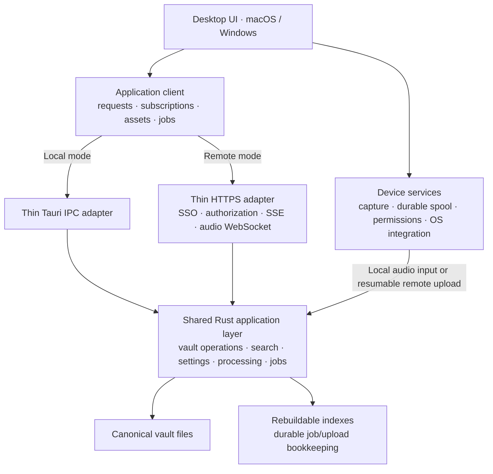

# Separate Loofah’s application backend from its desktop shell

Status: implementation in progress. The architecture and release gates below remain the full target; see the implementation audit at the end. Functionality is proposed unless verified there.

Inspection baseline: clean `main` at `a6a8f001d`, November 5, 2026. Root instructions and applicable plugin, fs-sync, and documentation instructions were inspected. No implementation or runtime testing was performed while preparing this plan.

## 1. Architecture and verified starting point

Build one Rust application layer that runs either **inside the desktop process** or **inside a standalone server**. Keep the existing macOS and Windows standalone experience, including offline use. Support Linux x64 for the standalone server.

### Local experience is a release requirement

For a single-person installation running everything on one device, nothing should change significantly: install Loofah, open it, and work locally or offline as today. Local mode is the default. The backend runs inside the desktop app, with no login, account, SSO, separately installed server, or company/vault administration required. Do not introduce remote provisioning or authentication into local startup. Login and shared-vault controls apply only when someone explicitly connects to a remote server.

Preserving this local onboarding and operating experience is an explicit acceptance criterion for every migration phase and the final release.

The first remote release includes the decisions made during planning:

- Company SSO.
- A personal vault automatically provisioned for each member.
- Self-service creation of shared vaults and membership management.
- Sharing with existing members of the configured company who have signed into Loofah.
- All remote-mode AI processing on the server, including live transcription.
- Online editing, with recovery of unsaved text and durable recording uploads during outages.
- ChatGPT subscription login remains local-only initially.

The shared layer is instantiated in the selected host; the diagram does not imply that local mode contacts a server.

### Findings from the current code

| Area                        | Verified boundary and implication                                                                                                                                                                                                                                                                                                              |
| --------------------------- | ---------------------------------------------------------------------------------------------------------------------------------------------------------------------------------------------------------------------------------------------------------------------------------------------------------------------------------------------- |
| Vault format                | [`vault-read`](../../crates/vault-read/src/lib.rs) already provides Tauri-independent readers and types. [`reserved.rs`](../../crates/vault-read/src/reserved.rs) defines exact session ownership. Preserve these contracts.                                                                                                                   |
| Vault writes                | [`vault-write::SessionStore`](../../crates/vault-write/src/lib.rs) already owns writes, in-memory indexing, transcript buffering, recording reservations, and change channels. Tauri event integration is optional. This is the foundation, not something to rewrite.                                                                          |
| IPC                         | [`session_store/commands.rs`](../../apps/desktop/src-tauri/src/session_store/commands.rs) mostly delegates to `SessionStore`. Some commands obtain settings or apply policy before delegation; move that policy into the shared layer. Errors currently cross IPC predominantly as strings.                                                    |
| Lifecycle and indexing      | [`startup.rs`](../../apps/desktop/src-tauri/src/startup.rs), [`vault_watch.rs`](../../apps/desktop/src-tauri/src/vault_watch.rs), and [`search_index.rs`](../../apps/desktop/src-tauri/src/search_index.rs) contain reusable orchestration wrapped in Tauri state/events. `search-cache` already provides the reusable Tantivy implementation. |
| Frontend data access        | [`index-query.ts`](../../apps/desktop/src/shared/index-query.ts) directly subscribes to Tauri events and assumes local requests, including `networkMode: "always"`. Session queries directly import generated Tauri commands. Replace those dependencies at the client boundary.                                                               |
| Concurrent editing          | [`save_note`](../../crates/vault-write/src/content.rs) serializes writes but accepts no expected revision. Summaries have an existing content comparison guard. A mutex prevents simultaneous execution, but does not prevent a later stale save from overwriting another client’s edit.                                                       |
| Recording and processing    | `listener-core` and `listener2-core` are reusable Rust crates with runtime interfaces, but capture and processing remain intertwined. [`useStartListening.ts`](../../apps/desktop/src/stt/useStartListening.ts) still coordinates transcript persistence, batch repair, and automatic summaries in the frontend.                               |
| AI workflows                | [`enhance-workflow.ts`](../../apps/desktop/src/store/zustand/ai-task/task-configs/enhance-workflow.ts) runs generation in TypeScript using the AI SDK. Provider construction, retries, validation, and success handling also span frontend modules. Extraction therefore includes moving business logic from TypeScript into Rust.             |
| Device and path assumptions | Attachment resolution and audio playback use `convertFileSrc`; imports accept local filesystem paths. Settings mix device preferences and vault behavior. Provider secrets currently live in the OS keychain. These cannot be exposed unchanged as remote APIs.                                                                                |
| CLI/MCP                     | [`apps/cli`](../../apps/cli/src/lib.rs) already operates without Tauri, using `agent-access`, `search-cache`, and `vault-write`. CLI mutations instantiate stores directly. [`mcp.rs`](../../apps/cli/src/mcp.rs) currently exposes read-only local tools/resources. Preserve that public capability boundary.                                 |
| Server portability          | Soniqo currently rejects Linux; its Windows implementation uses global live/batch state. Recording and batch actors also have global names. Linux support and concurrent processing require explicit work, even though much of the Rust code is already Tauri-independent.                                                                     |

Do not repurpose `plugins/relay` as the production backend. It is a Tauri-dependent development bridge.

## 2. Recommended boundaries and contracts

### Shared application layer

Introduce `crates/loofah-core`, composing existing components rather than relocating every crate:

- One `VaultContext` per opened vault: `SessionStore`, settings, search projection, watcher, event stream, and job coordination.
- Application operations for sessions, notes, summaries, transcripts, tasks, tags, people, attachments, imports, exports, and settings.
- Rust-owned recording ingestion, transcript persistence, post-recording repair, automatic summarization, and title generation.
- Shared provider implementations, prompt preparation, validation, retry policy, cancellation, and result application.
- Explicit startup, readiness, shutdown, and recovery interfaces.

Keep serialization and file-integrity primitives in `vault-read`, `vault-write`, `storage`, and `fs-sync-core`. Continue using `agent-access` for agent-facing projections.

Inject small host interfaces for secrets, runtime directories, processing resources, and notifications. Do not pass `AppHandle`, webview channels, or platform paths through application operations.

Device capture, permissions, microphone selection, system audio, tray/floating windows, browser launch, notifications, dialogs, and desktop updating remain in the desktop host. Split the processing portion of `listener-core` away from capture dependencies so the server does not require a desktop/audio-device stack.

### Public contracts and adapters

Introduce `crates/loofah-protocol` for shared request, response, error, event, revision, job, and asset DTOs. Generate TypeScript types using the repository’s existing Serde/Specta tooling. Keep endpoint registration and contract fixtures alongside these definitions.

Use explicit, versioned JSON operations under `/api/v1`, with separate endpoints for binary uploads, media, events, and audio streaming. Do not expose generic Tauri command invocation, arbitrary file reads/writes, or server filesystem paths.

Both adapters call the same application methods:

- **IPC:** existing generated command surface becomes thin adapter code.
- **HTTPS:** Axum handles authentication, transport validation, limits, and serialization.
- **Frontend:** one `ApplicationClient` exposes requests, subscriptions, job control, and asset resolution. UI components consume that interface.
- **Native remote transport:** Rust handles HTTPS connections and SSO credentials; the TypeScript remote adapter uses a narrow native bridge. Credentials stay out of ordinary UI state.

Use a separate device-services interface for capture and OS actions. Mode selection belongs in application bootstrap, not feature components.

### Errors, cancellation, and compatibility

- Return typed errors: validation, not found, forbidden, conflict, unavailable, incompatible version, resource limit, cancelled, and internal failure.
- Include request IDs, retryability, and current revision where useful. Never expose provider secrets or server paths.
- Distinguish a failed operation from a write that persisted before a later step failed. A dropped connection means the outcome may be unknown.
- Give mutations request IDs and replay-safe handling. Persist receipts for uploads, session creation, and job submission so retries cannot duplicate them.
- Reads accept cancellation. Cancelling a request does not roll back a committed write.
- Long operations return job IDs. Explicit cancellation is cooperative and observable; disconnecting a subscriber does not cancel a job.
- Negotiate protocol version and capabilities before opening a remote vault. Start with protocol major `1`; allow additive changes within that major and reject incompatible clients before mutations.
- Keep application version, API version, and vault-format compatibility separate. Existing automatic desktop releases must not require simultaneous server upgrades.

### Notifications and cache invalidation

Use authenticated **SSE for changes and job updates**, and a separate authenticated **WebSocket for live audio ingestion**. Axum already supports SSE and keepalives. [Axum SSE documentation](https://docs.rs/axum/latest/axum/response/sse/)

Extend existing entity/ID invalidations with vault identity, server epoch, and sequence cursor:

- Maintain a bounded replay buffer; no durable collaboration event log.
- Subscribe before initial reads. Revalidate after subscription establishment.
- On cursor gaps, buffer overflow, or server restart, send `resync_required` and invalidate the affected vault’s queries.
- Reconnect with bounded exponential backoff and jitter; heartbeat failures update connection state.
- Emit search-ready changes after projection updates so a query is not left stale after an early content notification.
- Job state and transcript snapshots remain queryable; progress events are not the sole record.
- Namespace caches and pending operations by connection, authenticated principal, and vault ID.
- Tear down subscriptions and clear visible remote data on account changes or lost access.

Preserve local offline query behavior. Remote connection handling must not pause local-mode queries merely because the machine has no internet connection.

### Vault ownership, authorization, and editing

Run one service instance over its configured storage root. It manages multiple vaults, each with an exclusive lifetime lock. Reject overlapping roots and a second process opening the same writable vault. Do not support active-active servers or writable network-shared mounts initially.

Use a small, atomically written **service catalog** outside session directories for identities, memberships, vault roots, and provisioning state. Canonical note content remains exclusively in vault files; search remains rebuildable.

Initial remote access model:

- One configured company OIDC issuer.
- Identity keyed by issuer and subject, not mutable email addresses.
- First successful authorized sign-in idempotently provisions one personal vault.
- Personal vaults are private and cannot be shared through the sharing UI.
- Members can create shared vaults; the creator becomes owner.
- Owners can add existing company members as readers, editors, or owners, remove members, and rename/delete shared vaults.
- Readers can read and search; editors can change content and run processing; owners also manage membership and vault policy.
- Prevent removal of the last owner.
- No external guests, invitation emails, cross-company tenancy, or automatic access to every shared vault.

Use authorization-code login with PKCE through the system browser and a native loopback callback. Validate access tokens against configured issuer, signature, audience, expiry, and required scopes; do not use ID tokens as API credentials. [OAuth for native apps](https://www.rfc-editor.org/rfc/rfc8252.html), [JWT access-token validation](https://www.rfc-editor.org/rfc/rfc9068.html)

Check authorization for every request, stream, upload, media access, and job operation. Membership removal closes affected streams and prevents further job result application. Remote vault paths are selected only through the server catalog.

Local mode does not instantiate this remote identity/provisioning flow. Its trusted local application context accesses the user’s existing vault without asking the user to authenticate.

For concurrent writes:

- Return opaque revisions for editable resources.
- Require expected revisions for full replacements and destructive operations.
- Compare against current canonical content under the vault write lock, rather than relying solely on cached index state.
- Keep note/title revisions independent of unrelated live transcript updates.
- Return conflicts without overwriting either version. Preserve the local draft and offer reload, copy, or explicit reconciliation against the latest revision.
- Apply generated results only when their target revision remains valid; retain conflicted output for review.
- Retain the existing overwrite protection, trash behavior, legacy-note fallback, and watcher hash checks.
- Document that per-file atomic writes are not multi-file transactions. Add recovery records for compound operations and test partial failures.

External filesystem editing remains supported locally. On server-owned vaults, direct filesystem mutation is an operator maintenance action performed while writes are stopped; filesystem watchers do not make uncoordinated external writers transactional.

## 3. Feature behavior in both modes

| Feature                        | Local mode                                                                                                 | Remote mode                                                                                                                                              |
| ------------------------------ | ---------------------------------------------------------------------------------------------------------- | -------------------------------------------------------------------------------------------------------------------------------------------------------- |
| Onboarding and login           | Default standalone experience; no login, account, SSO, or server setup.                                    | Explicit connection to a server and company SSO sign-in.                                                                                                 |
| Notes and editing              | Same editor and local persistence; works offline. Shared revision handling also protects multiple windows. | Reads and revision-checked saves use HTTPS. Pause editing when disconnected; preserve already-unsaved text for recovery. No general offline write queue. |
| Search                         | Existing local Tantivy projection.                                                                         | Per-vault server projection; bounded queries and paginated results. No downloaded remote-vault search index.                                             |
| Tasks, tags, people, templates | Existing canonical artifacts and shared operations.                                                        | Same operations with vault authorization and conflict protection.                                                                                        |
| Attachments                    | Native selection and existing managed attachment storage.                                                  | Upload bytes; resolve opaque asset references. Never send a client path as a server path. Loose unknown session files remain ignored.                    |
| Audio playback                 | Local asset access and waveform cache.                                                                     | Authenticated media access with byte-range support and server-generated peaks. Seeking must not download the whole recording.                            |
| Recording                      | Capture on device; shared processing runs locally.                                                         | Capture on device into durable local storage; stream/upload to the selected backend. Network failure cannot block capture.                               |
| Live transcription             | Existing local or configured provider processing through the shared Rust layer.                            | Server processes incoming audio and publishes transcript updates. During disconnection, capture continues and captions show their interrupted state.     |
| Batch transcription and repair | Local backend jobs using existing platform engines/providers.                                              | Durable server jobs using server-hosted CPU models or configured API providers.                                                                          |
| Imports and exports            | Native dialogs and paths remain local host concerns.                                                       | Upload input before starting server work; download exports before invoking local save/open actions.                                                      |
| Summaries and titles           | Shared Rust workflows, including existing local providers and ChatGPT support.                             | Server jobs continue without an attached frontend. ChatGPT subscription provider is initially unavailable remotely.                                      |
| Providers and secrets          | OS keychain and local model storage.                                                                       | Server secret storage and server model storage. `localhost` provider URLs refer to the backend machine.                                                  |
| Settings                       | Preserve existing `config.json` behavior and defaults.                                                     | Vault processing settings live server-side; appearance, devices, shortcuts, and connection preferences stay client-local.                                |
| CLI/MCP                        | Existing commands and read-only MCP behavior continue without requiring a desktop session.                 | Select server/vault profiles; reuse the HTTPS client and SSO credentials. MCP remains a local stdio bridge to authorized remote operations.              |
| OS integration                 | Existing macOS and Windows implementations.                                                                | Still device-local; remote mode does not relocate tray controls, permissions, floating windows, or meeting detection.                                    |

**Media:** return short-lived, asset-scoped access URLs after authorization, supporting range requests and automatic renewal. Recheck membership on access, redact tickets from logs, and never persist these URLs in Markdown. Persist only attachment identifiers/relative references.

**Provider configuration:** remote secrets are never returned by read APIs. Vault owners can configure permitted providers through write-only secret updates; ordinary editors select allowed models. Operator policy controls outbound provider endpoints, including explicitly configured private-network model hosts.

### Recording reliability is a separate pipeline

Implement a native capture spool outside the canonical remote vault, pinned to server, account, vault, session, and recording IDs.

1. Start durable local capture independently of connection establishment.
2. Upload numbered, checksummed audio chunks; acknowledge only durably stored chunks.
3. Keep unacknowledged chunks across disconnects and application restarts.
4. Feed server live transcription from contiguous received audio. Deduplicate retransmission.
5. If an outage creates a gap or excessive backlog, mark live output incomplete and repair from the completed recording.
6. Finalize canonical audio and transcript through shared application operations. Verify the final server artifact before removing acknowledged local capture data.
7. Run automatic summaries after transcript completion/repair, without requiring a frontend callback.

Use bounded queues and disk-space checks. Slow networking or inference must never block the capture thread. When local storage becomes exhausted, stop safely and report the exact failure; do not silently discard audio.

Starting a recording while offline creates a pending capture item, not an editable offline remote session. Authorization is rechecked before eventual session creation/upload. If access is revoked, retain the capture for local recovery rather than redirecting it to another vault.

### CLI ownership

Route local CLI operations through the active vault owner using a user-restricted Unix socket on macOS or named pipe on Windows. When no owner exists, the CLI can instantiate the same core under the vault lock.

This avoids independent `SessionStore` instances writing concurrently with the desktop. MCP resolves the owner per operation rather than retaining an unnecessary exclusive ownership lock while idle. Preserve existing CLI output contracts and MCP tool/resource names.

## 4. Deployment, lifecycle, and portability

Ship `apps/server` as one `loofah-server` executable, with a Linux x64 container and systemd deployment recipe. Keep a single service; no Redis, external queue, content database, or separate processing fleet.

### Local lifecycle

- Desktop bootstrap constructs the shared core with the selected local vault and device services.
- Preserve startup migration/readiness, index construction, watcher reconciliation, and bounded exit flushing.
- Shutdown stops capture, finalizes recoverable audio, checkpoints jobs, and flushes transcripts.
- Remote-mode desktop shutdown preserves the upload spool and disconnects; server jobs continue.
- Local macOS/Windows use requires neither login nor SSO nor a separately installed service. Linux server support adds no Linux desktop requirement.
- Existing single-person installations remain local by default, with no migration to accounts, company administration, or server provisioning.

### Server lifecycle

- Configure storage/cache roots, public URL, listen address, OIDC issuer/client/audience, provider policy, secrets, quotas, and worker limits.
- Bind behind an HTTPS reverse proxy; keep the application port private. Configure SSE buffering/timeouts and WebSocket upgrades explicitly.
- On startup, validate catalog/storage, acquire vault locks, recover operations and jobs, reconcile indexes, then mark vaults ready.
- Persist job state, upload manifests, and operation receipts as atomic files in service runtime storage, outside canonical session namespaces.
- On restart, resume safe uploads and queued work. Mark interrupted provider generations for explicit retry when replay could incur duplicate charges.
- On shutdown, stop admission, checkpoint work, flush writes, and terminate workers within a bounded deadline.
- Give live processing priority over background indexing and batch jobs, with configurable resource limits and fair scheduling across vaults.

### Portability work

- Ensure the server dependency graph excludes Tauri, Swift/Cocoa, Windows capture APIs, and audio-device initialization.
- Extract platform-neutral processing from the current listener crates.
- Replace global actor names and singleton inference state with recording/job-scoped instances or explicitly serialized model workers.
- Add Linux CPU support for the existing ONNX Parakeet live/batch path and validate Whisper and diarization dependencies.
- Preserve Apple-native acceleration and Windows implementations in local mode.
- Report capabilities accurately; Apple-specific model implementations are not automatically available on Linux.
- Port existing API-provider workflows from TypeScript to Rust and test prompt/result parity. Package model resources independently of Tauri resource paths.

### Storage, backups, and upgrades

- Use persistent local storage with reliable atomic rename and locking semantics.
- Preserve canonical filenames and unknown user files; add no runtime artifacts inside session directories.
- Back up whole vault directories, service catalog, and required job/upload bookkeeping. Back up secrets separately; caches/models can be regenerated.
- Provide a quiesced backup procedure and test restoration into an empty service.
- Run migrations under exclusive ownership after backup. Fail clearly on unsupported future formats.
- Upgrade the single service with a short controlled interruption. Clients reconnect; local capture continues.
- Expose readiness and content-free operational metrics for failed writes, upload backlog, event reconnects, job latency, and storage pressure.

Existing local vaults can be adopted through a documented, stopped-service copy/import procedure. This does not introduce ongoing synchronization between local and remote copies.

## 5. Incremental delivery, validation, and effort

Implement in an **isolated worktree**, using a `refactor/` branch. Run `scripts/setup-shared-target.sh` before the first Rust build there. Keep each phase reviewable and the local application working throughout.

| Phase                                             | Main changes and likely modules                                                                                                                                                   | Completion criterion                                                                                                                                                | Relative effort |
| ------------------------------------------------- | --------------------------------------------------------------------------------------------------------------------------------------------------------------------------------- | ------------------------------------------------------------------------------------------------------------------------------------------------------------------- | --------------- |
| **1. Establish the application seam**             | Add `loofah-core` and protocol types; compose `vault-write`, `search-cache`, settings, startup, watcher, and shutdown logic. Convert session IPC to application calls.            | Existing local flows pass; core tests run without Tauri; vault fixtures remain compatible.                                                                          | Medium          |
| **2. Introduce the frontend client**              | Add request/subscription abstraction; migrate session queries, `index-query`, mutations, configuration access, and asset interfaces. Keep IPC as the active transport.            | No feature UI branches on deployment mode; local offline behavior, event recovery, and multiple windows remain correct.                                             | Medium          |
| **3. Deliver the smallest useful remote slice**   | Add Linux server, OIDC login, catalog, automatic personal vault, authorized list/read/create/save-note operations, revisions, and SSE invalidation.                               | Two desktop clients can access one authorized test vault; a save appears on the other client; stale saves conflict; reconnect refreshes; unauthorized access fails. | Large           |
| **4. Complete vault access and content features** | Add shared-vault/member UI, roles, tasks/tags/people, summaries-as-documents, attachments, range playback, imports/exports, native CLI owner bridge, and remote CLI/MCP profiles. | Personal/shared isolation holds across every endpoint and event; existing content workflows work remotely; CLI cannot bypass ownership.                             | Large           |
| **5. Move processing into Rust jobs**             | Port enhancer/title workflows and provider construction; move transcript persistence and post-capture orchestration out of React; add durable jobs and Linux CPU processing.      | Jobs complete without a frontend; cancellation/restart/conflict behavior is tested; local provider behavior is preserved.                                           | Very large      |
| **6. Add resilient remote capture**               | Split capture from processing; implement spool, chunk upload, live audio ingestion, server transcript events, repair, and finalization.                                           | Long recordings survive outages and restarts without missing/duplicated audio; final server artifacts are verified before local cleanup.                            | Very large      |
| **7. Release hardening**                          | Deployment artifacts, restore/upgrade tests, performance work, documentation, compatibility fixtures, and platform CI.                                                            | All release gates below pass; remote setup is reproducible; local macOS/Windows regression QA passes.                                                               | Large           |

Phase 3 is the first useful end-to-end milestone. Keep remote mode explicitly experimental until the complete feature matrix and reliability gates pass.

### Required validation

- **Local experience:** fresh installation and upgrade on macOS and Windows remain login-free; no server/SSO setup is required; the existing vault opens and offline capture, editing, search, and local processing remain available without contacting an identity service.
- **Storage and conflicts:** existing vault fixtures; legacy `_memo.md`; unknown/dot files; attachment collisions; symlink/path traversal; two-client saves; deleted sessions; AI output racing manual edits; disk-full and multi-file partial failures.
- **Isolation:** same session IDs in different vaults; private-vault invisibility; reader mutation denial; forged vault/job/upload IDs; membership revocation during streams and processing; account switching; concurrent first-login provisioning.
- **Contracts:** matching IPC/HTTPS semantics, generated-type drift checks, unknown fields, unsupported protocol versions, typed errors, lost-response retries, and cancellation after commit.
- **Networking:** real HTTPS/SSE/WebSocket clients through a proxy at approximately 50, 150, and 500 ms RTT; jitter, bandwidth limits, dropped connections, expired tokens, server restart, and event-buffer overflow.
- **Recording:** at least a two-hour capture with repeated outages, a ten-minute disconnect, app restart after capture, server restart, and upload retry. Verify chunk hashes, duration, channel alignment, transcript repair, and absence of duplicates.
- **Responsiveness:** production macOS build with realistic large vaults while recording, searching, uploading, and running AI work. Measure interaction latency and memory against the current baseline.
- **Platforms:** Linux server tests plus native Windows x64 and ARM64 `windows-ci`; run its speech-model checks for processing changes. Validate macOS capture and local inference separately.
- **Deployment:** clean installation, SSO setup, backup/restore, interrupted upgrade recovery, and compatible older-client/newer-server behavior.

Follow the repository’s Axum testing split: in-process `oneshot` tests for routes and middleware; real listeners for streaming, reconnects, and lifecycle. After implementation edits, run dprint, relevant frontend checks, Rust checks/tests, and affected CLI/docs checks. Update user and agent documentation in the same phases.

### Risks and planning estimate

The dominant risks are frontend-to-Rust AI parity, multi-recording inference isolation, capture recovery, authorization coverage, and crash recovery across compound file operations. The core vault extraction is comparatively modest because much of it already exists.

A rough planning allowance is **18–30 engineer-weeks** for the complete scope selected here, including SSO, self-service shared vaults, Linux processing, and recording hardening. The note-only remote milestone is roughly **4–7 engineer-weeks** within that total. Re-estimate after phases 1 and 3.

Product choices are settled for this plan. Remaining deployment inputs are the actual SSO configuration, domain, capacity limits, and approved provider endpoints; they do not change the architecture.

This delivers a standalone local application and a multi-vault remote application over one Rust backend implementation. Mobile clients, external guests, broader company administration, real-time collaborative editing, “bases,” CRDTs, and general offline remote-vault synchronization remain later work.

## Implementation audit

Work is isolated on `refactor/frontend-backend-separation` in the `loofah-backend-separation` worktree. This audit records progress against the original scope; passing a phase does not complete the full plan.

- [ ] **Phase 1: shared application layer.** `loofah-core` now contains startup, settings persistence, watcher reconciliation, search orchestration, a vault context, and headless lifecycle. Desktop startup, settings, watcher, search, and summary policy use this layer. `loofah-protocol` defines generated request/error/change/note contracts. Note replacements support revisions checked against canonical bytes under the write lock. Remaining: finish adapter parity and platform validation.
- [ ] **Phase 2: frontend client.** Session, people, tags, timeline, transcript queries, and index subscriptions use a local `ApplicationClient` adapter. Remaining: cover all requests, assets, settings, jobs and capture; connection selection and cache lifecycle; typed error and revision UX. The existing editor still uses its original local save contract pending that migration.
- [ ] **Phase 3: first remote slice.** `apps/server` now provides the headless executable, OIDC JWT validation, a file-backed company catalog, private-vault provisioning, explicit authenticated HTTP operations behind HTTPS termination, and SSE replay/resync. Shared note creation has durable retry receipts. Native browser PKCE login, OS credential storage, typed HTTPS requests and authenticated SSE now have a desktop bridge. Scoped client caches, request/subscription adapters and revision-aware draft state are implemented but are not mounted in the existing UI. Remaining: connection/vault selection and UI migration, editor conflict UX, and real HTTPS/latency/disconnect validation.
- [ ] **Phase 4: vault sharing and content.** Shared-vault membership/roles, revision checks, rename/delete and existing-member directory APIs are implemented. The sharing UI, remaining remote content operations, media/import/export, CLI ownership IPC, and remote CLI/MCP remain to implement. The new headless runtime takes a lifetime vault lock; the desktop/CLI ownership change has not yet been enabled.
- [ ] **Phase 5: processing.** Frontend AI workflows, durable jobs, remote providers, server model management, and Linux inference parity remain to implement.
- [ ] **Phase 6: resilient remote capture.** Native durable capture spool, authenticated ingestion, live transcription, resumable uploads, repair and finalization remain to implement.
- [ ] **Phase 7: release hardening.** Linux backend and native Windows CI include shared backend coverage. Linux container, systemd and Caddy recipes now exist, with container/proxy checks added to CI. Restore/upgrade, full compatibility, network/disconnect, two-hour recording, production performance and native desktop release QA remain required.

Local remains the default and no authentication or account provisioning has been added to local startup. No remote deployment is selectable yet. This implementation must remain experimental until every acceptance criterion above is verified.

### Foundation checkpoint validation

Verified locally on macOS on November 5, 2026:

- Shared core: 56 tests passed. Protocol: 2 tests passed. Vault writes: 269 passed, 1 pre-existing ignored test.
- Desktop Rust: 41 passed, 1 pre-existing ignored test. CLI: 111 tests passed across unit and integration targets. Settings/search plugin tests passed.
- Desktop frontend: all 208 files and 1,582 tests passed; TypeScript checking passed.
- Rust checks for desktop and CLI passed; protocol generation drift check passed; formatting, whitespace checks and the repository's high-severity workflow security gate passed.
- The Linux dependency graph has no Tauri, webview or device-capture dependencies. Native Linux and Windows execution remains a CI gate, rather than a claim established by this macOS run.

Local build artifacts must remain on T7. Both Cargo target symlinks were verified to resolve onto the T7 filesystem; task temporary files, compiler caches and validation logs are under `/Volumes/T7/loofah-backend-build/`.

### Authenticated service checkpoint

`apps/server/README.md` documents the experimental backend, OIDC configuration, API headers, deployment and stopped-service backup procedure. The desktop still selects local IPC only; this checkpoint does not enable the remote desktop experience.

Verified locally:

- 18 server unit/transport tests and a real executable startup/SIGTERM test pass without desktop resources.
- Shared core: 58 tests passed. Protocol: 2 passed. Vault writes: 270 passed, 1 existing ignored test.
- Completed create receipts read current canonical files and never restore a deleted session. Canonical storage and the private-text search cache are restricted to the service user.
- Tests cover signed-token issuer/audience/scope/expiry/type/signature rejection, concurrent private provisioning, last-owner protection, reader denial, revision conflicts, duplicate/lost-response retries, incomplete-create recovery, unknown attachments, symlink isolation, cancellation during catalog commit and first vault initialization, SSE reconnect/replay/overflow, catalog invalidation and revocation/expiry closure.
- Desktop/CLI/server Rust checks and desktop TypeScript checking pass. Contract generation has a drift check. The executable reports the root package version.

On the foundation commit, Linux headless, macOS Rust, frontend, CLI, formatting and security CI passed; CLI infrastructure's initial Launchpad HTTP 503 passed on retry. Native Windows checks were still running at this checkpoint. The expanded server/container CI must run on the new commit before platform validation is claimed.

Still required for the first usable remote slice: native browser login with PKCE and secure credential storage, desktop HTTPS/SSE transport, connection/vault selection, scoped cache teardown, revision-aware editor recovery, and validation through actual HTTPS with realistic network conditions. Processing, media, capture reliability, CLI owner routing and the remaining release gates remain part of the full objective.

### Native transport checkpoint

`crates/loofah-client` provides reusable browser PKCE login, serialized refresh-token rotation, typed requests, cancellation and bounded SSE decoding/reconnect. The desktop bridge keeps tokens in Rust and stores refresh credentials in the OS credential store under a separate native service. Windows share one native authentication coordinator per server configuration; releasing a window does not close another window's connection. Sign-out cancels active work and supports retry when credential deletion fails.

Verified locally:

- 12 native-client tests, including a real trusted HTTPS proxy at 50, 150 and 500 ms round trips. Login, requests and SSE replay survive connection closure; an untrusted certificate is rejected.
- Two native clients log in against the actual server, create/read/save one canonical note, observe a change, and reject a stale replacement. Server coverage is now 19 unit/transport tests plus the executable lifecycle test.
- Native bridge tests cover window connection leases and cancellation/unsubscription arriving before admission. Frontend transport tests cover aborts, typed errors, response validation, subscription teardown and sign-out races.

The frontend still selects local IPC. Connection selection, scoped caches/drafts and revision-aware editor recovery remain necessary to finish the first usable remote slice. The complete feature matrix, processing/capture work and release gates remain open.

### Shared frontend contract and draft checkpoint

Typed local IPC and HTTPS now expose the same paginated session reads, coherent note snapshots, revision-checked saves, idempotent creation and bounded search operations. Pagination and search validation live in the shared Rust application layer. Local creation receipts stay outside the canonical vault and are keyed to its canonical path. The local adapter publishes the same change contract as the server, including search readiness; bulk invalidations are bounded.

`VaultClient` captures its server/account/vault scope. `VaultScope` owns a separate query cache, cancels old reads, ignores late events, revalidates on reconnect/focus and removes cached private content after authorization loss. `NoteDraft` pins the original baseline on the first keystroke without serializing Markdown in the input handler, retains newer edits while a save is pending, serializes writes through its captured client, and requires explicit review before rebasing a conflict. Exact lost-response retry matches can be acknowledged; absent and explicitly empty notes remain distinct.

Validation: 33 frontend contract/cache/draft tests pass, including undo during a pending save, discarded queued autosaves, account/vault switching, lost responses, readers and lazy draft capture. Desktop Rust, headless shared operations and server integration are checked alongside these changes. The draft recovery representation is ready for native device persistence; that persistence and the mounted editor/profile UI are still pending. The existing editor continues to use its original local path until that migration is complete.
